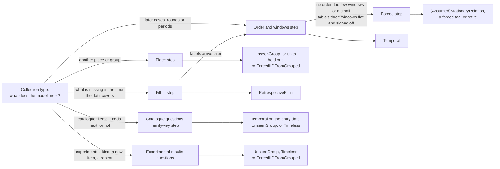

# Deciding a split from the data collection type

This is the decision tree SPLIT-36 in [splits.md](splits.md) asks you to walk for every definition's split. Its root
is the record's data collection type (SPLIT-34). Each type asks what the model meets in use, and most answers link to
one of five shared steps, written once below the types: the place step, the fill-in step, the order and windows step,
the forced step and the catalogue's family-key step. A leaf names the split and what justifies it: the time basis of
SPLIT-32, a forced tag of SPLIT-8, `ForcedIIDFromGrouped` of SPLIT-35, or for a temporal split the windows and the gap.

## How to walk it

* Start at the record's collection type and answer each question from what it says it reads. A question is one of
  four kinds: _use case_ (the source's stated application and the definition's use case), _data and documentation_
  (the raw rows, the source's account of how the data was collected), _measurement_ (a number you compute and write
  into the time basis), or _person decides_ (see "Who answers" below).
* A bold step name after an arrow (**Place step**) is a link: continue at that step's first question. The brackets
  after a link name the time key the step works on, and `here:` lists definitions that take that link.
* Answer as if no split had been decided. The leaf you reach is the split to implement, with the tag in its title:
  `Random · ...` is an IID split, `Grouped · ...` a `grouping`, `Temporal · ...` a `temporal` declaration, `Retire ·
  ...` a dataset the curator retires or keeps on their own call. A `ForcedIIDFromGrouped` leaf sits beside a time
  basis (SPLIT-35), which the leaf or the type's other answers give.
* Every question and leaf has an ID in square brackets after its text: `[DB.meets]` for a question, `[L-FILL.unit]`
  for a leaf. IDs stay when the text changes; cite them in a `splits_comment`, a review or a record's `Split:` line.
  A definition names the leaf it reaches in `split_leaf`, and a definition that departs from it is added to the table
  at the end.
* A use case that meets both another place and a later time takes the place step; its time basis names the later time
  as untested.
* A use case the source states (a paper, a competition, a data card) answers the use-case questions (USE-1). A split
  the source prescribes is evidence, not an answer: it answers a question only where the source chose it for that use
  case. Where it matches the leaf, its official periods, gap and training history fill in the leaf (SPLIT-19); where
  it differs, the leaf decides, and the `splits_comment` says what the source prescribed and why it does not fit the
  use case (SPLIT-5), as a departure for a reviewer.
* Where a definition ships another split than its leaf, its `splits_comment` names the leaf and why the definition
  departs; the departure goes to a reviewer. Confirmed departures are listed at the end with their reason; a resolved
  one leaves the list.
* The examples under a leaf (at most three) are v0.2 definitions that reach it; read one before writing yours. A leaf
  no definition reaches says so.
* Known gaps, for a reviewer when you meet one: a transfer to another laboratory or instrument outside Experimental
  results, and a panel whose units each have only their own sequence (no split inside each unit can be declared yet).

## Who answers

An agent walks the tree and answers every question but these five, which only a person answers. At each, the agent
gives the facts for and against, may recommend an answer, and goes on with the answer named below until a person has
given theirs:

1. **The windows exception** `[ORDER.exception]`, `[CAT.exception]`: training down to 30%, wider windows than the use
   case's, or no gap (SPLIT-14, SPLIT-10). The agent answers no.
2. **A test window length, refit cadence or gap the source does not give** (the windows check): the agent proposes one
   and marks it for sign-off (SPLIT-12).
3. **Signing off a flat reading** of the stationary-relation test as `StationaryRelation` `[FORCED.reason]`, also
   over a small table's only three windows `[ORDER.small]`, `[CAT.small]`. The agent answers no, so the windows stay.
4. **A reason for `AssumedStationaryRelation`** where nothing can be measured `[FORCED.reason]`. The agent answers no.
5. **Declining the risk of temporal leakage** for a forced split `[FORCED.risk]` (Andrej, 2026-11-19). The agent
   answers no, so the forced split stands.

A reviewer also sees every forced leaf (`ForcedIIDFromTemporal`, `ForcedGroupedFromTemporal`, `ForcedIIDFromGrouped`,
a compromise the use case does not ask for), every leaf no v0.2 definition reaches yet, every departure, and every
question no answer fits: only a reviewer adds a branch.

## Words

* **Time basis**: why a split that is not temporal is not, declared as `TimeBasis(tag, reason)` and rendered as the
  `Time basis:` line. **Group basis**: why a split is random although the use case holds out a group
  (`ForcedIIDFromGrouped`), beside the time basis.
* **IID** in `ForcedIIDFromTemporal` and `ForcedIIDFromGrouped` means a random split of the rows, not a judgement that
  the rows are independent.
* **`RetrospectiveFillIn`**: the use case fills in what is missing for the time the data covers (rows without a
  label, places a survey did not sample, occasions a panel did not record), not a later time. It was called
  `Retrospective`, which clinical readers take for "a retrospective study" and ML readers for a backtest; the old name
  is still read until every definition uses the new one.
* **Unit**: the recurring thing the unit check asks about (a patient, a car, a station, a policy). **Item**: an entry
  of a catalogue or an experiment (a molecule, a mix). **Group**: a place, region, site, family or kind that holds
  many units or items. **Scored unit**: what SPLIT-33 counts.
* **Window**: a test block of a temporal split. **Period**: a span of time the data covers. **Occasion**: one
  observation of a panel's unit. **Round**: one wave of a survey ("wave" only for survey rounds). **Test window
  length**: how much time a window covers; a forecaster's "horizon" is the planning lead, which sets the gap.
* **Contain** for what the data has; **hold out** only for what the split keeps out of training.
* **Rebuilt order**: an order the release does not record but the data allows (an id issued in sequence, the file's
  row order), **checked** and recorded as `Time: Inferred`. The check is never against the order itself: against
  something dated independent of it where the data or its surroundings hold any — a second column that is dated, a
  dated subset from a linked release, dated facts outside the file, a quantity that counts calendar time (an age, a
  business age) — else against evidence only a time order explains (renewals that link one period to the next, items
  that appear or retire along it), which makes the order a judgement call named in `splits_comment`.
* **Hint**: a collection fact (`Samples:`, `Time:`, `Target:`, `Entities:`) points to where to look; it never answers
  a question by itself.
* **Prediction point**: when the model is used for a case; `Samples: One Moment` means every case shares one.

## Overview

The types differ in their first question; the steps are shared. Bold names below are sections of this file.

## Checks the steps cite

* **The enough-groups check.** Several places, groups or kinds are enough to hold out when every test fold can hold
  whole groups with every class present; fewer count as one (covertype's four areas; the weighed factor 'Only a few
  groups').
* **The unit check** (USE-10, SPLIT-24). A unit has several rows when a unit id repeats, recorded or rebuilt exactly
  from the data (a stone, a car, a household, a policy, a patient, a survey cluster, a respondent's several items).
  Grouped by the unit where the use case meets new units; random where it meets more rows of units the data contains,
  or where each unit has one row. Exact copies are dropped, not grouped (LEAK-19); repeats that matter but cannot be
  identified retire the dataset, for a reviewer (SPLIT-25). Hint: `Entities: Recur`.
* **The same-time check** (SPLIT-32, question 2). Under a `RetrospectiveFillIn` leaf, no row of a test row's time may
  carry its target (one day's weather across stations); if one does, group by that time unit.
* **The windows check** (SPLIT-12, SPLIT-14, SPLIT-15, SPLIT-33). The test window length, the refit cadence, the gap
  and the time unit come from the use case and the source; where they are silent, a person sets them before the
  question is answered. Each window keeps the training share and the scored units SPLIT-14 sets. The number of windows
  aims at the splits an IID split of the data would get (SPLIT-15), never under three, fewer with the reason in the
  `splits_comment`; windows do not overlap by default, and where the target cannot be reached otherwise, overlapping
  windows are offered to the curator. Too few positives in a window is part of the task, not a reason to leave the
  branch.
* **The gap rules** (SPLIT-10), under every temporal leaf:
  - late labels: a gap of about the delay, or training only on cases whose outcome is known before the window (a
    delivery, a chargeback, a recorded sale);
  - a planning lead the use case states (a forecast issued a day ahead): the lead is the gap, and a lead that makes the
    task look like forecasting is first checked for tabular scope (SEL-11, TP-10);
  - an outcome window still open at the next scoring date (a 20-day return, a policy year's claims when the next tariff
    is set): training only on cases whose outcome window has closed;
  - no gap where the delay is within the time column's resolution (a date: one day) or a written exception holds;
  - where a cut on the arrival date would train on cases that close inside the window, and the order in which the
    targets arrived can be rebuilt from the data (SPLIT-22), cut on that order instead: it is the strictest form of
    training only on closed cases, so it needs no gap, and it arrives with the target, so it is no model input
    (`time_of="label"`).
* **The stationary-relation test** (SPLIT-32). It asks whether the relation between the features and the target holds
  in later periods: per period, a forward model trained on the rows before it against a contemporaneous model trained
  on as many rows of the period itself, and whether a class share moves. It reads the newest three periods the data
  or a parent source covers (fewer give a partial reading). SPLIT-32 says when a reading is flat, not flat or
  inconclusive; the reading goes into the time basis.

## Expanding science catalogue

A cut of a scientific database or testing programme that keeps growing (SPLIT-34). Its split follows SPLIT-37, and in
every leaf an item's copies stay on one side.

**Does the use case predict for the items the catalogue adds next?** [CAT.next-items] _(use case; reads SPLIT-37 step
3: the source's stated aim and scope (abstract, methods, caveats); its own split counts only where chosen for the use.
Items like those it was built from, or items from elsewhere (other sites or instruments) → no; compounds not yet made,
materials not yet reported, or no scope stated → yes)_
- no: items like those it contains, or from elsewhere → **Family-key step** (here: open_soil_spectral_library,
  qsar_biodeg, superconductivity)
- yes, or no scope stated →
  **Does each item carry a final date of entry into this catalogue, with a final label?** [CAT.entry-date] _(data and
  documentation; reads SPLIT-37 step 4: a date of entry into this catalogue in the release or a parent source, not a
  registration that predates it; items still to come, not an inventory already collected, a closed study or a
  designed experiment; labels that are not revised later (hint: the `Time:` fact, `Target: Revised Later`))_
  - no → **Family-key step** (here: drug_induced_autoimmunity_prediction, nci_aids_antiviral_screen,
    qsar_oral_toxicity)
  - yes →
    **Does arrival change how the target is recorded or which items are taken in, or does a forward split leave
    clearly fewer close training neighbours than a random draw?** [CAT.arrival] _(measurement; reads SPLIT-37 step 4a:
    a change in how the target is recorded or in which items are taken in that moves with the entry date (a change in
    how features are recorded is a fact for the notes); step 4b: close training neighbours of each test item under a
    forward split against a random one)_
    - no → **Family-key step** (here:
      force_2020_well_well_log_and_lithofacies_dataset_for_machine_learning_competition, protein_model_quality_rf_pcp,
      qsar_aquatic_toxicity)
    - yes →
      **Can the entry dates hold at least three test windows of the use case's size?** [CAT.windows] _(data and
      documentation; reads the span and density of the entry dates; the windows check)_
      - yes →
        **Does a person sign off a flat reading over a small table's only three windows?** [CAT.small] _(person
        decides; as the same question of the order step: SPLIT-33's 20- or 10-repeat tier, three windows, the test
        over them read flat and signed off as `StationaryRelation`; an agent offers it with the reading and answers
        no)_
        - no → **Temporal · entry date** [L-CAT.entry-date]. Each period tested on the earlier ones; an item keys on
          its first date, which orders the split and is no input; the gap by the gap rules. Examples: apistox,
          qsar_tid_11.
        - yes → **Family-key step**
      - no →
        **Does a person allow an exception that gives three windows: training down to 30%, wider windows than the use
        case's, or no gap?** [CAT.exception] _(person decides; SPLIT-14, SPLIT-10; an agent offers it with the numbers
        and answers no)_
        - yes → **Temporal · entry date, with a person's exception** [L-CAT.entry-date-exception]. As above; the
          exception goes in the `splits_comment` and a CC line. No v0.2 definition reaches it yet.
        - no → **Family-key step**

## Experimental results

Runs of a designed experiment, or a closed set of specimens, molecules or volunteers measured by a laboratory or a
study protocol (SPLIT-34). Most have no time; the use case decides whether one matters.

**What does the model meet in use?** [EXP.meets] _(use case; reads the use case: samples that arrive one after another
(sent to a certification body, visitors at a screening point); a kind or family the data does not contain (a problem
class, a target gene, a chemical series); another laboratory, site or instrument; a new item of the kinds the data
contains (a new mix, a new volunteer); further measurements of items already measured (a robustness or repeatability
study))_
- later samples, one after another → **Order and windows step** (time key: a recorded date, or an order rebuilt from the
  data such as a file position or an id; here: wine_quality)
- a kind or family the data does not contain →
  **Can the data compute that kind?** [EXP.kind-key] _(data and documentation; reads a problem class, a target gene, a
  chemical series (a scaffold, SPLIT-31) computed from the data, not from the label; the enough-groups check)_
  - yes → **Grouped · `UnseenGroup` (the kind)** [L-EXP.kind]. Whole kinds held out with all their rows and repeats.
    Examples: airfoil_self_noise, asp_potassco_classification, huesken_sirna_efficacy.
  - no → **Random · `ForcedIIDFromGrouped` (no kind key)** [L-EXP.no-kind-key]. The data cannot compute the kind (a
    chemical series without structures): random, beside the `Timeless` time basis, the overlap it leaves named in the
    group basis. Examples: bioresponse.
- another laboratory, site or instrument → **Place step**
- a new item of the kinds the data contains →
  **Was the experiment repeated, giving several rows for one item?** [EXP.repeated] _(data and documentation; reads
  the raw file and the source's design: replicates, test ages of one mix, conformations of one molecule; exact copies
  are dropped, not grouped (LEAK-19) (hint: `Entities: Recur`))_
  - yes → **Grouped · `Timeless` (the item)** [L-EXP.item]. Whole items held out with all their rows. Examples:
    concrete_compressive_strength, micro_mass, musk.
  - no → **Random · `Timeless`** [L-EXP.random]. One row per item; molecules with exact structures group on the
    scaffold instead (SPLIT-31). Examples: biogeographical_ancestry_prediction, body_density_prediction,
    forensic_glass_identification.
- further measurements of items already measured → **Random · `Timeless` (further measurements)** [L-EXP.further].
  The other repeats of an item in training are the use case, not a leak. No v0.2 definition reaches it yet.

## Clinical study

Patients of a clinical study, a clinic's case series or a registry, labelled by a diagnosis or a follow-up outcome,
with no date recorded per row (SPLIT-34).

**Where, and for whom, will the model be used?** [CLI.meets] _(use case; reads the use case: another hospital or site;
later patients at the same clinic)_
- at another hospital or site → **Place step** (here: gossis_icu_hospital_mortality)
- at the same clinic, for later patients →
  **Do the raw rows record a date per patient?** [CLI.dated] _(data and documentation; reads the release: an admission,
  entry or visit date in the raw rows, not one rebuilt from the data)_
  - yes → **Dated event log** (the record's type changes, SPLIT-34)
  - no → **Order and windows step** (time key: an order rebuilt from case numbers, encounter numbers or deposit
    batches and checked as a rebuilt order asks; here: diabetes_130_us, framingham_heart_study_fhs,
    regensburg_pediatric_appendicitis)

## Survey

Rows the survey collected itself, by its questionnaire or its sampling design, in one round or in rounds of different
respondents (SPLIT-34).

**Whom, and when, does the model predict for?** [SUR.meets] _(use case; reads the use case: later respondents; the
population at a later round; people or places the survey did not sample, inside the population and area it covered
(gaps between sampled sites, respondents like these) or outside them (groups or places it never reached))_
- later respondents, arriving one by one without rounds → **Order and windows step** (time key: a recorded interview
  date, or an order rebuilt from the data; here: caracas_cervical_cancer)
- the surveyed population at a later round → **Order and windows step** (time key: the rounds a round or date column
  records, such as an election year or an observation date, or rounds rebuilt from the data; here: anes_voting_2026,
  sdss_17)
- people or places the survey did not sample, inside what it covered → **Fill-in step** (here:
  boreal_postfire_lichen_biomass)
- groups or places outside what the survey covered → **Place step** (here: early_learning_predictors)

## Database snapshot

An organisation's records released as one extract with no date recorded per row: read for one date or period, or
cases that arrived over time with their dates dropped (SPLIT-34).

**What does a model trained on the snapshot meet in production?** [DB.meets] _(use case; reads the use case: rows of
this snapshot that lack the label (a listing among listings, unmapped land); units of a place or group the snapshot
does not contain (a new municipality, branch or region); a whole population scored at a date, for what happens after
it; new cases that arrive one by one)_
- rows of this snapshot that lack the label → **Fill-in step** (here: covertype, diamonds, houses)
- units of a place or group the snapshot does not contain → **Place step**
- a whole population scored at a date, for what happens after it → **Order and windows step** (time key: scoring dates
  rebuilt from the data, such as a second labelled file of the same population; one reference date, or several mixed
  with their dates lost, give no order; here: account_debt_south_africa, allstate_claim_prediction_challenge_1m,
  blood_transfusion)
- new cases that arrive one by one → **Order and windows step** (time key: an order rebuilt from an id issued in
  sequence or the export's row order; here: amazon_employee_access, aps_failure, fremtpl2,
  labour_inspection_compliance)

## Dated event log

Each row is one event (a trip, an order, a loan, a sale, a report, an admission) whose raw row records its date
(SPLIT-34).

**What does the model meet?** [LOG.meets] _(use case; reads the use case: a new hospital or region; the gaps of the
period the data covers (a record not taken, a value not read); cases after the data (an order, a trip, a loan, a
booking, a tariff))_
- a place or group the data does not contain → **Place step** (here: heart_disease)
- the gaps of the period the data covers → **Fill-in step**
- cases after the data → **Order and windows step** (time key: the arrival date; the scoring date where the open
  cases are scored at a date such as a month-end or a tariff year's start; or the order in which the targets arrived,
  where a cut on the arrival date would train on cases that close inside the window and that order can be rebuilt from
  the data: it is the strictest form of training only on closed cases, so it needs no gap, and it arrives with the
  target, so it is no model input; here: acquire_valued_shoppers_challenge, bad_customer_detection,
  california_house_prices_2020, hotel_booking_demand)

## Panel data

The same units observed at repeated periods or visits, one row per unit and occasion (SPLIT-34).

**Does the model fill in the period the panel covers, or predict after it?** [PAN.when] _(use case; reads the use case:
occasions the panel covers but did not record, or units it did not observe then (a reading not taken, a station not in
the network) → fill in; the next month of the same stores, the next visit of the same patients, new patients or
stations after the data → after it)_
- fill in the covered period → **Fill-in step** (here: 5g_energy_consumption,
  fraud_detection_in_electricity_and_gas_consumption_1m, tunisian_fraud_detection_challenge)
- predict after it →
  **Which units does the model predict for?** [PAN.units] _(use case; reads the use case: later occasions of units the
  panel contains, also when new units join them → the same units; units not in the data and no known unit's later
  occasions → only new units; a new hospital or station network → another place)_
  - the same units, or both the same and new units →
    **Do the units share a calendar, or does each have only its own sequence?** [PAN.calendar] _(data and
    documentation; reads the raw rows: a date, month or year all units share → shared; only a visit number or hours
    since admission → its own sequence (hint: `Time: Dated`, `Time: Within Entity`))_
    - a shared calendar → **Order and windows step** (time key: whole periods across all units; here:
      rossmann_store_sales, garments_worker_productivity, spanish_motor_insurance_coverage_level_2022_2024)
    - each unit's own sequence → **Temporal · each unit's last occasions (not declarable yet)** [L-PAN.own-sequence].
      Each unit's last occasions tested, its earlier ones in training. Data Foundry cannot declare a split inside each
      unit yet (a grouped split holds whole units out), so a case here goes to a reviewer. No v0.2 definition reaches it
      yet.
  - only new units → **Grouped · `UnseenGroup` (new units)** [L-PAN.new-units]. Whole units held out; their earlier
    occasions serve as context only where the use case reads them (`Grouping` with `time_on` and context
    `past_rows`); the later calendar stays untested, as the time basis says. Examples: amex_non_iid_1m,
    dementia_prediction, sepsis_prediction_1m.
  - units of a place or group the panel does not contain → **Place step**

## Place step

Reached when the model is used at a place or group the data does not contain: another hospital, region, site,
laboratory or station network.

**Does the data contain several of those places or groups?** [PLACE.several] _(data and documentation; reads a
hospital, region, site, laboratory or network column; the enough-groups check)_
- yes → **Grouped · `UnseenGroup` (groups)** [L-PLACE.groups]. Whole places or groups held out with all their units and
  occasions. Examples: early_learning_predictors, gossis_icu_hospital_mortality, heart_disease.
- no: one place or group →
  **Does a unit have several rows, and does the use case meet new units?** [PLACE.units] _(data and documentation;
  the unit check; a panel's units always have several rows, and those of another place are new)_
  - yes → **Grouped · `UnseenGroup` (units; the other place untested)** [L-PLACE.units]. Whole units held out, the
    closest split; the step to another place stays untested, as the time basis says. No v0.2 definition reaches it
    yet.
  - no → **Random · `ForcedIIDFromGrouped` (one place, the transfer untested)** [L-PLACE.random]. Random; the transfer
    to another place stays untested, as the group basis says. Examples: deafness_gene_carrier_hearing_loss,
    pheochromocytoma_paraganglioma_metastasis.

## Fill-in step

Reached when the model fills in what is missing for the time the data covers: rows that lack the label, people or
places a survey did not sample, occasions a panel did not record. Every `RetrospectiveFillIn` leaf takes the same-time
check.

**Do the rows that lack the target lie later in time than the labelled ones?** [FILL.later] _(data and documentation;
reads label presence against the time column, and the source's account of how a label arrives: an audit, a settlement
or a follow-up that closes after the record → later)_
- yes: the labels arrive later → **Order and windows step** (time key: the time column, the newest labelled period
  tested on the earlier ones, the gap set by the label's delay; here: tunisian_fraud_detection_challenge)
- no →
  **Are the rows to fill in scattered among labelled ones, or whole units, areas or groups?** [FILL.scattered] _(use
  case; reads the use case: a listing among listings, a reading not taken at a station that reports, a respondent like
  those sampled → scattered; a station not in the network, unmapped land, a producer new to the shop → whole)_
  - scattered →
    **Does a unit have several rows, and does the use case meet new units?** [FILL.units] _(data and documentation;
    the unit check: a stone, a car, a survey cluster, a respondent's several items)_
    - yes → **Grouped · `RetrospectiveFillIn` (the unit or cluster)** [L-FILL.unit]. Whole units or sampling clusters
      held out. Examples: boreal_postfire_lichen_biomass, diamonds.
    - no → **Random · `RetrospectiveFillIn`** [L-FILL.random]. Random is the use case; a unit's other rows in training
      are no leak. Examples: fiat_500, houses, immoscout_german_house_prices.
  - whole units, areas or groups →
    **Does the data contain a key for them?** [FILL.key] _(data and documentation; reads a unit, group or site column,
    or a location fine enough to cut blocks)_
    - yes → **Grouped · `RetrospectiveFillIn` (whole units, areas or groups)** [L-FILL.whole]. Whole units, areas or
      groups held out with all their rows. Examples: 5g_energy_consumption,
      fraud_detection_in_electricity_and_gas_consumption_1m, wine_world_cost.
    - no → **Random · `ForcedIIDFromGrouped` (no key)** [L-FILL.no-key]. Random beside the `RetrospectiveFillIn` time
      basis; the share of test rows whose neighbours sit in training goes in the group basis. Examples: covertype.

## Order and windows step

Reached when the model predicts later cases, rounds, periods or occasions. The link names the time key; the gap
follows the gap rules.

**Is an order of arrival recorded, or can it be rebuilt from the data and checked?**
[ORDER.order] _(data and documentation; reads the time key the link names, and SPLIT-22: an order the release does not
record but the data allows (an id issued in sequence, the export's row order, case or encounter numbers, a recovered
survey round), checked as the rebuilt order asks and recorded as `Time: Inferred`. A rebuilt order is never checked
against itself: against something dated independent of it where there is any, else against evidence only a time order
explains, which makes it a judgement call. The order is lost, nothing checks it, or every case is predicted at one
point (a cohort scored at one baseline exam, hint: `Samples: One Moment`) → no)_
- no: the order is lost, or every case is predicted at one point → **Forced step**
- yes →
  **Can the order hold at least three test windows of the use case's size?** [ORDER.windows] _(data and
  documentation; reads the span and density of the time key; the windows check)_
  - yes →
    **Does a person sign off a flat reading over a small table's only three windows?** [ORDER.small] _(person
    decides; reads SPLIT-33's tier (an IID split's training side under 2,500 units: 20 or 10 repeats), the number of
    windows the windows check gives, and the test of the checks section over those windows. An agent runs the test
    and, where it reads flat, offers the sign-off with the reading, and answers no; four windows or more, a larger
    table, or a reading not flat or inconclusive → no)_
    - no → **Temporal · windows on the time key** [L-ORDER.windows]. Each window tested on the earlier ones; the gap by
      the gap rules; a rebuilt order orders the split and is no input. Examples: diabetes_130_us, hotel_booking_demand,
      infrared_thermography_temperature.
    - yes → **Forced step**
  - no →
    **Does a person allow an exception that gives three windows: training down to 30%, wider windows than the use
    case's, or no gap?** [ORDER.exception] _(person decides; SPLIT-14, SPLIT-10; an agent offers it with the numbers
    and answers no)_
    - yes → **Temporal · windows on the time key, with a person's exception** [L-ORDER.exception]. As above; the
      exception goes in the `splits_comment` and a CC line. Examples:
      airqo_low_cost_air_quality_monitor_calibration_challenge, ashrae_great_energy_predictor_iii_1m,
      thyroid_discordant_archive.
    - no → **Forced step**

## Forced step

Reached when a forward use case has no usable windows: the order is lost, every case is predicted at one point, or
the windows are too few and no exception was allowed; or when a person signs off a flat reading over a small table's
only three windows (`[ORDER.small]`). It first asks for a reason to treat later samples as interchangeable with the
data's (SPLIT-32), the only way such a use case keeps a split that is not temporal; without
one, the split is forced (SPLIT-8).

**What does the stationary-relation test read?** [FORCED.test] _(measurement; reads the test of the checks section
where the data or a parent source holds time (a date, a rebuilt order, two periods or more), over the longest span
the source or a parent covers; no time, or one period → nothing measurable)_
- not flat →
  **Can whole periods be held out, enough for the repeats, without entity leakage?** [FORCED.periods] _(data and
  documentation; reads SPLIT-16 and SPLIT-8: whole periods of a date, a phase, a round or a rebuilt order, held out as
  a temporal split holds out its windows; enough for the repeats SPLIT-33 sets, each period with enough rows and, under
  a metric one class leaves undefined, a positive; a unit's rows stay in one period, or the unit goes with its period
  (USE-10, LEAK-17). No unit or random fallback: the relation moves with time)_
  - yes → **Grouped · `ForcedGroupedFromTemporal` (periods, measured not flat)** [L-FORCED.periods]. Whole periods held
    out, training also on later ones; the reading in the time basis, the step forward untested. Examples:
    lung_cancer_epithelial_genexp, online_shoppers_purchasing_intention_dataset, sendy_logistics_challenge.
  - no → **Retire · Too Small** [L-FORCED.too-small]. Too few periods, or too few positives in them, to approximate
    the temporal split (SPLIT-16, TP-9): retired, or kept only on the curator's call. Examples:
    ai4d_lab_tanzania_tourism_classification_challenge, open_university_learning_analytics_dataset.
- flat, or nothing measurable (no two periods, or an inconclusive test) →
  **Has a person given a reason to treat later samples as interchangeable with the data's?** [FORCED.reason] _(person
  decides; SPLIT-32 allows two: a flat reading that a person signs off, written `StationaryRelation (<person>,
  <date>): <reading>`; or, where nothing can be measured, a person's reason from the domain or the use case, written
  `AssumedStationaryRelation (<person>, <date>): <reason>`. An agent offers either with the facts for and against, and
  answers no)_
  - yes, a flat reading signed off →
    **Does a unit have several rows, and does the use case meet new units?** [FORCED.flat-units] _(data and
    documentation; the unit check)_
    - yes → **Grouped · `StationaryRelation` (the unit)** [L-FORCED.flat-unit]. Whole units held out; the reading in
      the time basis, a later period untested. Examples: horse_colic_survival,
      spanish_motor_insurance_coverage_level_2022_2024.
    - no → **Random · `StationaryRelation`** [L-FORCED.flat-random]. Random; the reading in the time basis, a later
      period untested. Examples: bad_customer_detection, cirrhosis_patient_survival_prediction,
      regensburg_pediatric_appendicitis.
  - yes, a reason where nothing can be measured →
    **Does a unit have several rows, and does the use case meet new units?** [FORCED.assumed-units] _(data and
    documentation; the unit check)_
    - yes → **Grouped · `AssumedStationaryRelation` (the unit)** [L-FORCED.assumed-unit]. Whole units held out; the
      person's reason in the time basis. No v0.2 definition reaches it yet.
    - no → **Random · `AssumedStationaryRelation`** [L-FORCED.assumed-random]. Random; the person's reason in the time
      basis. Examples: distribution_transformers_at_cauca_department.
  - no →
    **Does a person decline the risk of temporal leakage for this use case?** [FORCED.risk] _(person decides; a forced
    split trains on rows from the same time as the test rows, or later, so a shift the data cannot show can make its
    score look better than the use case will see; where the domain makes such a shift likely (prices, fraud, a policy
    or a population that changes), a person may decline it. An agent answers no and may flag the question with the
    facts for and against)_
    - yes → **Retire · forced split too risky** [L-FORCED.too-risky]. No forced split represents the task (`Not
      Representative`): retired, or kept only on the curator's call with the judgement in a CC line. No v0.2
      definition reaches it yet.
    - no →
      **Can meaningful groups be built without entity leakage: the unit the use case meets new, else whole periods
      enough for the repeats?** [FORCED.groups] _(data and documentation; reads USE-10, SPLIT-24 and SPLIT-8: the unit
      check, else whole periods of an order (a date, a phase, a round, a presentation or a rebuilt order) enough for
      the repeats SPLIT-33 sets; a unit's rows stay in one group)_
      - yes → **Grouped · `ForcedGroupedFromTemporal`** [L-FORCED.groups]. Whole units or periods held out, so no
        unit's outcome sits on both sides; the step forward untested. Examples: allstate_claim_prediction_challenge_1m,
        aps_failure, pricing_game_2017_french_mtpl.
      - no → **Random · `ForcedIIDFromTemporal`** [L-FORCED.random]. Random; the step forward untested. Examples:
        account_debt_south_africa, blood_transfusion, churn_telco_south_asia.

## Family-key step

The catalogue's default split (SPLIT-37 step 2), reached when the entry date does not decide: a use case that stays
with items like those the catalogue contains or aims elsewhere, no final entry date, arrival that changes nothing, or
too few windows on the entry date. A catalogue does not carry `ForcedIIDFromGrouped`.

**Can the data compute a family key: a scaffold, an element set, a protein target, a site, a survey or an
instrument?** [FAMILY.key] _(data and documentation; reads SPLIT-37 step 2: a key computed from the data, not from the
label; the scaffold for molecules (SPLIT-31), the survey or site that stands for elsewhere (step 3); the enough-groups
check)_
- yes → **Grouped · `UnseenGroup` (the family key)** [L-FAMILY.key]. Whole families held out, each item's copies with
  them; how the catalogue grew goes in the notes with its measurement. Examples: drug_induced_autoimmunity_prediction,
  nci_aids_antiviral_screen, qsar_oral_toxicity.
- no →
  **Does an item have several rows (re-measurements)?** [FAMILY.repeats] _(data and documentation; reads SPLIT-37 step
  1: an item id or a structure that repeats in the raw file (a compound tested twice, a composition reported in several
  papers); exact copies are dropped, not grouped (LEAK-19) (hint: `Entities: Recur`))_
  - yes → **Grouped · `Timeless` (the item)** [L-FAMILY.item]. Whole items held out with their re-measurements; the
    family the use case would hold out goes in the notes. No v0.2 definition reaches it yet.
  - no → **Random · `Timeless` (no family key)** [L-FAMILY.random]. Random; the family the use case would hold out goes
    in the notes with the overlap the split leaves. No v0.2 definition reaches it yet.

## Definitions that ship another split

These v0.2 definitions ship a split other than their leaf's; a reviewer confirmed each departure, for the reason given.
None does at present.

| Definition | Leaf | Ships | Reviewer | Date | Reason |
|---|---|---|---|---|---|
