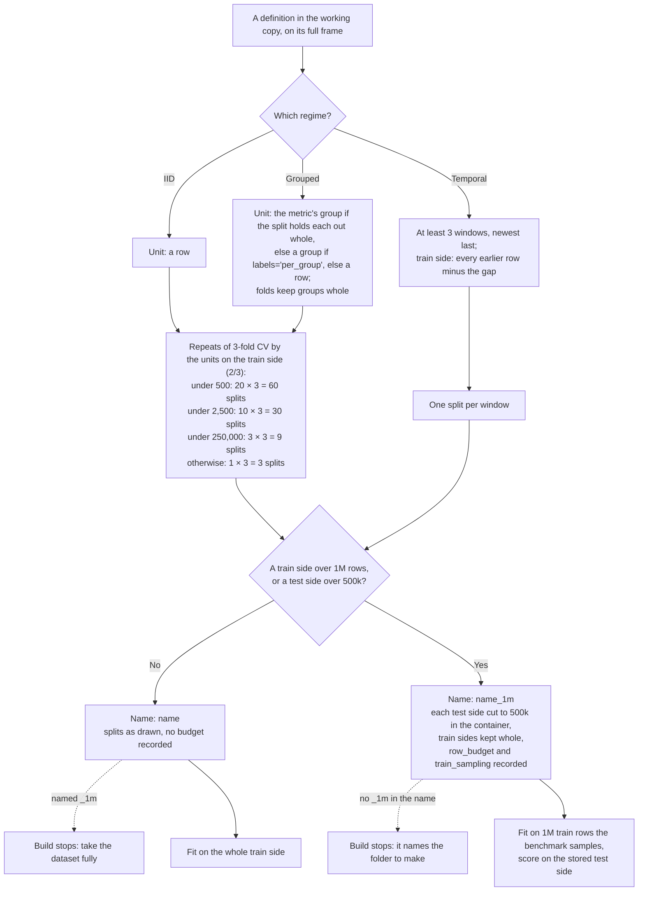

# The split protocol: rows, splits and the row budget

How a v2 dataset of the TabArena v0.2 working copy turns its rows and groups into the splits a model is trained and
scored on, from the definition to the fit. It implements the split rules of knowledge-curation
([splits.md](../../knowledge-curation/references/splits.md)); how to declare the splits in a `dataset.py` is in
[definitions.md](definitions.md). The code is
[`src/data_foundry/v2/splits.py`](../../../../src/data_foundry/v2/splits.py) (the protocol) and the base class in
[`src/data_foundry/v2/dataset.py`](../../../../src/data_foundry/v2/dataset.py); the working copy sets its budget once
in [`collection.py`](../../../../datasets/_dev/tabarena-v0pt2/collection.py).

- Every task has at least 3 test folds: IID and grouped data get repeated 3-fold cross-validation, temporal data at
  least 3 time windows.
- IID and grouped tasks get 20, 10, 3 or 1 repeats by the units on the train side, at any size of the frame: the
  groups the metric scores when the split holds each out whole (SPLIT-33), else the groups when one label covers a
  group, else the rows.
- The row budget (1M train, 500k test rows per split) applies after the split, and only to a version named
  `<name>_1m`: its container caps each test side, and the benchmark samples the train side before each fit.
- A definition declares no budget; the build refuses a name that does not match what its splits need.
- The folds, the repeats and the budget are defaults: a dataset whose task needs other splits deviates on purpose and
  says why ([Defaults and deviations](#defaults-and-deviations)).

## The decision tree

**Splits.** IID: stratified 3-fold cross-validation over the rows. Grouped with `per_group` labels: the folds are
drawn over the groups and stratified by each group's label. Grouped with `per_sample` labels: shuffled group k-fold, a
new draw per repeat. Temporal: the windows of `TemporalSplits`, one split each. Every split and sample uses the seed
4267.

**The `_1m` version.** It reads the raw files of `<name>` and gets the budget from `collection.py` by its name. Each
test side keeps at most 500,000 rows: stratified rows (IID), whole groups (grouped), rows or whole time values
(temporal). In IID and grouped folds the test rows over the cap train in that fold; a temporal frame keeps only the
rows some split uses. For IID and grouped data this happens above about 1.5M rows (3 × 500k); for temporal data it
depends on the windows, since the newest train side holds almost the whole frame.

**At fit time.** When the container records a budget, `subsample_train(container, repeat, fold)` draws the 1M training
rows: stratified rows (IID), whole groups (grouped), or the newest year before the window, extended back in time until
it holds 1M rows, then a random 1M of those (temporal). Without a budget the model trains on the whole train side.
The score is taken on the test side as stored.

## Defaults and deviations

The protocol is the default, not a constraint on the task (SPLIT-1 in
[splits.md](../../knowledge-curation/references/splits.md): the split mirrors the application).

- **Other splits.** A definition whose task needs other folds or repeats implements `_make_splits` (returning a
  `SplitPlan`), says why in `splits_comment`, and accepts the check `splits_dimensions_off_protocol` with that reason
  in `accepted_check_warnings`. Precedent: heart_disease holds out one hospital at a time, 3 splits, since more
  repeats would draw the same three folds again. Temporal windows are chosen per dataset anyway (`TemporalSplits`,
  SPLIT-15).
- **Another budget for every dataset.** The budget is the collection's: change `row_budget` in `collection.py` (and
  `TABARENA_V0PT2_ROW_BUDGET`), and every version follows on its next build; a new train budget renames the versions
  (`RowBudget.suffix`: `_1m`, `_2p5m`, `_10m`).
- **Another budget for one dataset.** Not possible today: a definition of the working copy that declares `row_budget`
  is refused, so all of TabArena v0.2 trains and tests on the same budget. A custom `_make_splits` keeps its sides
  within the budget itself (sample there), since the build refuses a plain name whose splits go over it.

## Examples

| Dataset | Regime and units | Splits | Budget | Fits on |
|---|---|---:|---|---:|
| `blood_transfusion` | IID, 748 rows | 60 | no | about 499 rows |
| `covertype` | IID, 581,012 rows | 3 | no | about 387,341 rows |
| `wadden_sea_sibes_macoma_abundance` | grouped `per_sample`, 59,044 rows (5,092 stations) | 9 | no | about 39,363 rows |
| `electric_motor_temperature_prediction` | grouped `per_sample`, 1,296,316 rows (69 profiles) | 3 | no | about 864,211 rows |
| `fraud_detection_in_electricity_and_gas_consumption_1m` | grouped `per_group`, 81,531 clients (1,862,650 rows) | 9 | test sides 500,000 | 1,000,000 rows |
| `amex_non_iid_1m` | grouped `per_group`, 458,913 customers (5,531,451 rows) | 3 | test sides 500,000 | 1,000,000 rows |
| `kick` | temporal, 9 windows (72,983 rows) | 9 | no | up to 69,278 rows |
| `nyc_taxi_trip_duration_1m` | temporal, 3 windows (about 1.45M rows) | 3 | train sides 1.28M to 1.39M | 1,000,000 rows |

Sizes are from each dataset's `README.md`, and for the `_1m` versions from the full-frame counts their definitions
state (their containers were built before the budget moved after the split, issue #70).

## What stops a wrong split

| Guard | When | What it stops |
|---|---|---|
| Loading the definition | every load | a `row_budget` declared in a definition of the working copy |
| The build | `dataset check`, `dataset build` | a name that does not match what the splits need |
| Protocol checks | every container | other repeats or folds (warning), a test side over the budget (warning), a budget without its train sampling (error), fewer than 3 windows (warning) |
| README test | `pytest` | a `README.md` over the budget, or one that does not record it |
| Collection check | `verify=True`, `check_collection_bundles.py` | a container that breaks the budget, once the collection is registered |

## Where it is set

| What | Value | Set in |
|---|---|---|
| Folds per repeat | 3 | `N_FOLDS` |
| Repeats by train-side units | under 500: 20, under 2,500: 10, under 250,000: 3, else 1 | `REPEATS_BY_TRAIN_SIZE` |
| Temporal windows | at least 3 | `MIN_TEMPORAL_SPLITS` |
| Row budget | 1,000,000 train, 500,000 test rows per split | `TABARENA_V0PT2_ROW_BUDGET`, via [`collection.py`](../../../../datasets/_dev/tabarena-v0pt2/collection.py) |
| Name of a version with the budget | `<name>_1m` | `RowBudget.suffix`, `effective_row_budget` |
| Seed | 4267 | `SPLIT_RANDOM_STATE` |

**Open:** a grouped task whose metric scores rows, with `per_sample` labels, counts rows, although its folds move
whole groups. Counting the held-out groups for every grouped task would change the repeats of 14 more of the 39
grouped datasets (electric_motor and the FORCE 2020 well logs from 3 splits to 60).
