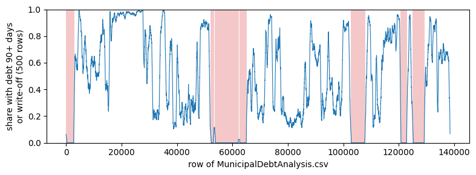

# account_debt_south_africa

> Generated from [`dataset.py`](dataset.py) by `dataset check` (or `build`). Do not edit this page: change `dataset.py` and re-run the check.

Binary classification of `BadDebt`, scored with `roc_auc` on IID splits. 101,871 rows and 7 features. Source: Kaggle (2020).

Not built yet. The current definition gives checksum `v2:14c792e2c2d96a1827828705eea01f800aae07fd2defe288a22b4d49a3d0817a`.

## In brief

**Question.** Has a municipal billing account turned into bad debt?

**Use case.** A South African municipality scores its accounts to forecast how many, and how much, will turn into bad debt, and where to direct collection.

**One row.** One billing account of one of eight municipalities, summarised over two years.

**Predicted.** Whether the account is a bad debt (debt overdue 90 days or more, or written off) at the end of those two years; 56% are.

**Known at prediction time.** The account type, the property's value and size, whether an ID number is on file, and what was billed over the two years (in total, per bill, for electricity), not what was paid.

**What the test data stands for.** Random accounts of the same municipalities at the same time.

**Our changes to the source.** We drop the three debt columns that define the label, the payments of the same two years, and stretches of the file where no debt was recorded.

> **Use case fit: approximate (a stand-in with a known gap).** The file is one snapshot: the status at its date stands in for the forecast the data card describes (fit on one snapshot, score the next), and the features cover the same two years as the label.

## Files in this folder

| file | what it is |
|---|---|
| [`dataset.py`](dataset.py) | The definition, and the only file edited by hand: metadata, reading and cleaning the raw files, feature types and splits. |
| [`explore.ipynb`](explore.ipynb) | The workbench for looking at the data (`ds = workbench()`), committed without outputs. Not needed to rebuild. |
| [`README.md`](README.md) | This page, generated by `dataset check` and `dataset build`. |
| [`figures/`](figures) | The figures of the decisions below, generated with this page. |

- The curation record, with the triage decision and its sources: [`curation/records/account_debt_south_africa.md`](../../../../curation/records/account_debt_south_africa.md)
- The original source: <https://www.kaggle.com/datasets/dmsconsultingsa/municipal-debt-risk-analysis>
- The collection this folder belongs to: [`tabarena-v0pt2/README.md`](../README.md) and [`tabarena-v0pt2/CHANGELOG.md`](../CHANGELOG.md)

## Rebuild

`dataset.py` reads its raw files from `local-data-warehouse/account_debt_south_africa/`. To get them:

```text
We download version 1 of the Kaggle dataset (the only version, 4 June 2020). It holds one file,
MunicipalDebtAnalysis.csv (138,509 rows, md5 d5fa5aaf696e31a65eebb0532fa4568d). OpenML 43838
(Municipal-Debt-Risk-Analysis) is a copy of the same rows in the same order.

mkdir -p local-data-warehouse/account_debt_south_africa && cd local-data-warehouse/account_debt_south_africa && kaggle datasets download dmsconsultingsa/municipal-debt-risk-analysis/1 && unzip municipal-debt-risk-analysis.zip && rm municipal-debt-risk-analysis.zip && cd ../../
```

Then, from the repository root:

```bash
.venv/bin/python -m data_foundry.curation.cli dataset check datasets/_dev/tabarena-v0pt2/account_debt_south_africa   # pipeline and checks, no UUID; rewrites this page
.venv/bin/python -m data_foundry.curation.cli dataset build datasets/_dev/tabarena-v0pt2/account_debt_south_africa   # also saves the container and records its UUID
```

Only curators run `build`, when the dataset ships.

## Dataset and task

| field | value |
|---|---|
| source | Kaggle: https://www.kaggle.com/datasets/dmsconsultingsa/municipal-debt-risk-analysis |
| year | 2020 |
| domain | finance |
| license | CC0-1.0 |
| data_tags | IID, ForcedIIDFromTemporal |
| reference | rawlins2020municipal |
| rows x columns | 101,871 x 8 |
| task.target | BadDebt |
| task.problem_type | binary_classification |
| task.metric | roc_auc |
| task.split_regime | iid |
| task.stratify_on | BadDebt |

<details>
<summary>Feature types: 2 categorical, 0 string, 0 datetime</summary>

- categorical (2): `AccCategory`, `BadDebt`
- string (0): none
- datetime (0): none

</details>

<details>
<summary>BibTeX</summary>

```bibtex
@misc{rawlins2020municipal,
  author = {Rawlins, Dylan},
  title = {Municipal Debt Risk Analysis},
  year = {2020},
  howpublished = {\url{https://www.kaggle.com/datasets/dmsconsultingsa/municipal-debt-risk-analysis}},
  note = {Kaggle dataset, DMS Technologies}
}
```

</details>

## Sample rows

The first 5 of 101,871 rows of the final frame (random rows: the frame is shuffled). Cells are cut at 40 characters.

| BadDebt | AccCategory | PropertyValue | PropertySize | TotalBilling | AverageBilling | TotalElectricityBill | HasIDNo |
|---|---|---|---|---|---|---|---|
| No | Residential | 650000 | 5182 | 5307 | 885 | 354 | 0 |
| Yes | Residential | 61000 | 512 | 3950 | 107 | 0 | 1 |
| No | Residential | 545000 | 896 | 29139 | 327 | 20013 | 0 |
| Yes | Residential | 485000 | 469 | 2 | 0 | 0 | 1 |
| Yes | Residential | 324600 | 261 | 5340 | 64 | 0 | 1 |

## Curation notes

We start with MunicipalDebtAnalysis.csv (138,509 accounts of eight South African municipalities) from version 1 of the Kaggle dataset.

- Prediction point: an account at the date of the extract, with its category, property, ID number on file and billing of the two years before; the label is its bad-debt status then.
- We drop `total90debt`, `totalwriteoff` and `debtbillingratio`: they set the label (decision table).
- We drop the 27,938 rows (20.2%) of seven runs of 1,185-8,762 consecutive file rows without any debt aged 90+ days or write-off, where debt was not recorded: none of their billed never-payers is a bad debt, against 91.5% outside (decision table; `NO_DEBT_RUN_ROWS` = 1,000).
- Anomaly: a 186-row run (from row 91,971) of billed never-payers without bad debts stays; a lower threshold would also drop two runs of paying accounts (218 and 334 rows).
- We follow the uploader's cohort and drop 8,700 accounts with no net billing in the two years, whose debt predates the window, or with negative payments.
- We drop the payment totals `totalreceipting`, `avgreceipting` and `collectionratio`: the status is read at the end of the two years they sum (decision table). ROC AUC 0.952 with them, 0.874 without.
- We drop `accountcategoryid` and `acccatabbr` (the category again), rename to the data card's names, and set a `PropertyValue` or `PropertySize` of 0 to missing.
- Potential leak, kept on purpose: `TotalElectricityBill`, which the data card adds as "a means to recover debt" (a cut-off for arrears). Its signal is mostly whether the municipality bills electricity at all; among billed accounts it is the same share of the bill for bad debts and others (median 0.33), so cut-offs within the window leave no trace. ROC AUC 0.874 with it, 0.865 without.
- Potential leak, kept on purpose: `HasIDNo`, by the data card a property of the holder ("often not captured properly or at all"). Accounts with one are bad debts more often (Residential 64% against 47%), so it may be captured when debt is pursued. ROC AUC 0.874 with it, 0.872 without.
- We keep the 6,355 exact duplicate rows (6.2%), plausibly distinct accounts with the same property record or flat charge; without the copied test rows, ROC AUC falls from 0.874 to 0.867.
- Anomaly: the file ends with a run of category Unknown (rows 134,192-138,276; 2,396 curated rows), mostly billed 1-3 times in two years; its never-payers with 1-3 bills are bad debts at 53% (86% elsewhere). Debt is recorded there, so it stays.
- IID, forced: the file is one extract without dates, so the task (bad-debt status at the extract) stands in for the data card's forecast, a model trained on one snapshot scoring the next.
- A municipality scores its own accounts, so its level is known information. The eight municipalities have no column; held out by file position, ROC AUC falls from 0.877 (random) to 0.843 (blocks of 2,500 rows) and 0.786 (thirds of the file).

## Splits

Default splits.

3 repeat(s) x 3 fold(s) with seed 4267; train 67,914 rows, test 33,957 rows.

| repeat | fold | n_train | n_test |
|---|---|---|---|
| 0 | 0 | 67914 | 33957 |
| 0 | 1 | 67914 | 33957 |
| 0 | 2 | 67914 | 33957 |
| 1 | 0 | 67914 | 33957 |
| 1 | 1 | 67914 | 33957 |
| 1 | 2 | 67914 | 33957 |
| 2 | 0 | 67914 | 33957 |
| 2 | 1 | 67914 | 33957 |
| 2 | 2 | 67914 | 33957 |

## Decisions

### 1. Debt aged 90+ days and write-offs set the label: dropped

Every account with debt aged 90 days or more or a write-off is a bad debt, and all but 371 others are not. `total90debt`, `totalwriteoff` and `debtbillingratio` are dropped (the uploader's notebook drops them too).

| account | bad debt | not a bad debt |
|---|---|---|
| debt aged 90+ days or write-off | 63600 | 0 |
| neither | 371 | 74538 |

### 2. The payments of the same two years: dropped

The label is read at the end of the two years whose payments `totalreceipting`, `avgreceipting` and `collectionratio` sum. The bad-debt rate falls from 91.5% for accounts that paid nothing to 14.7% for accounts that paid 87.5-105% of their billing (curated rows, before the column drops).

| paid / billed in the two years | rows | bad-debt rate |
|---|---|---|
| 0 (never paid) | 41081 | 0.915 |
| 0-0.5 | 6631 | 0.896 |
| 0.5-0.875 | 6377 | 0.621 |
| 0.875-1.05 | 28918 | 0.147 |
| above 1.05 | 18864 | 0.289 |

### 3. Seven runs of the file without any recorded debt: dropped

Inside the runs no account that was billed and never paid is a bad debt; outside them most are. Debt was not recorded there. Rows of the file are counted from 0 after the header.

| rows of the file | rows | bad debts | billed, never paid | bad-debt rate of those | ID number on file |
|---|---|---|---|---|---|
| 18-2,965 | 2948 | 0 | 39.0% | 0.0% | 0.0% |
| 52,170-53,354 | 1185 | 3 | 24.4% | 0.0% | 0.7% |
| 53,616-62,377 | 8762 | 0 | 15.0% | 0.0% | 0.0% |
| 62,466-65,246 | 2781 | 2 | 52.4% | 0.0% | 0.0% |
| 102,647-107,966 | 5320 | 0 | 86.1% | 0.0% | 0.0% |
| 120,562-123,075 | 2514 | 0 | 61.5% | 0.0% | 0.0% |
| 125,010-129,437 | 4428 | 0 | 37.1% | 0.0% | 0.0% |
| all other rows | 110571 | 63966 | 37.1% | 91.5% | 53.1% |

### 4. Where the runs lie in the file

The share of accounts with debt along the file (rolling over 500 rows); the dropped runs are shaded.



## Bundle checks

0 error(s), 0 warning(s), 1 info (26 checks run, plus the dataset's own checks).

- **info** `dataset_conflicting_duplicate_rows`: 554 row(s) (0.5%) share all features with another row but carry a different target. (hint: Either the rows differ in a dropped column, or the label is noisy — this caps the achievable score.)

Accepted on purpose:

- `dataset_duplicate_rows`: Kept on purpose: plausibly distinct accounts with the same property record or the same flat charge (162 accounts billed R6 in six R1 lines); the file has no account id to tell copies from accounts. Without the copied test rows, LightGBM ROC AUC on the first split falls from 0.874 to 0.867 (curation_comments).

## Data checks

### Feature summary

| index | dtype | n_missing | pct_missing | n_unique | examples |
|---|---|---|---|---|---|
| AccCategory | category | 0 | 0 | 12 | Residential, Unknown, Agricultural, Business, Government, Municipal, Educationa… |
| BadDebt | category | 0 | 0 | 2 | Yes, No |
| PropertyValue | float64 | 8943 | 8.78 | 9304 | 60000.0, 40000.0, 50000.0, 1100000.0, 80000.0, 55000.0, 35000.0, 1200000.0, 250… |
| PropertySize | float64 | 8849 | 8.69 | 13527 | 240.0, 300.0, 200.0, 275.0, 600.0, 264.0, 286.0, 276.0, 250.0, 220.0 |
| TotalBilling | int64 | 0 | 0 | 28410 | 1, 2, 12, 7321, 15, 1079, 4177, 6031, 178, 6 |
| AverageBilling | int64 | 0 | 0 | 4113 | 1, 0, 2, 3, 4, 5, 8, 7, 9, 6 |
| TotalElectricityBill | int64 | 0 | 0 | 12420 | 0, 2126, 703, 3132, 2445, 352, 176, 273, 88, 527 |
| HasIDNo | int64 | 0 | 0 | 2 | 1, 0 |

### Target distribution

| BadDebt | count | pct |
|---|---|---|
| Yes | 57199 | 56.15 |
| No | 44672 | 43.85 |

### Numeric features

| index | count | mean | std | min | max |
|---|---|---|---|---|---|
| PropertyValue | 92928 | 866178 | 3.23277e+06 | 1 | 4.2186e+08 |
| PropertySize | 93022 | 607813 | 4.74558e+06 | 1 | 2.70516e+08 |
| TotalBilling | 101871 | 13655.7 | 147508 | 1 | 2.61336e+07 |
| AverageBilling | 101871 | 601.474 | 5250.01 | 0 | 725934 |
| TotalElectricityBill | 101871 | 5000.69 | 116462 | -16171 | 2.27117e+07 |
| HasIDNo | 101871 | 0.537798 | 0.498572 | 0 | 1 |

### Categorical features

| column | rank | value | count | pct |
|---|---|---|---|---|
| AccCategory | 1 | Residential | 74748 | 73.38 |
| AccCategory | 2 | Unknown | 7217 | 7.08 |
| AccCategory | 3 | Agricultural | 6967 | 6.84 |
| AccCategory | 4 | Business | 6676 | 6.55 |
| AccCategory | 5 | Government | 2486 | 2.44 |
| BadDebt | 1 | Yes | 57199 | 56.15 |
| BadDebt | 2 | No | 44672 | 43.85 |

## Build

Not built yet. `dataset build` saves the container to the warehouse and records its UUID, checksum and provenance here.
