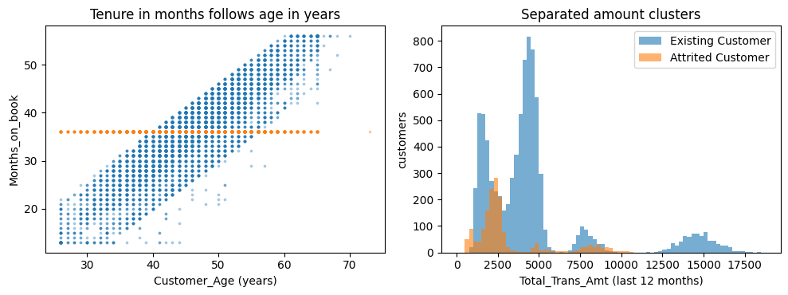

# credit_card_customers

> Generated from [`dataset.py`](dataset.py) by `dataset check` (or `build`). Do not edit this page: change `dataset.py` and re-run the check.

Binary classification of `Attrition_Flag`, scored with `roc_auc` on IID splits. 10,127 rows and 19 features. Source: Other (2020).

Not built yet. The current definition gives checksum `v2:56b99612ba387247490344fa7a4fcc7d20befc5b834e36c6a58c15c98324c3dd`.

## In brief

**Question.** Will a bank's credit card customer close the card account?

**Use case.** At a snapshot date, a bank scores each credit card customer for the risk of closing the account, from the profile and the last 12 months of card activity, so that a manager can contact the customer first.

**One row.** One credit card customer of a bank at one snapshot (10,127 customers), from a teaching case of Analyttica's LEAPS training platform; the bank, place and period are not stated.

**Predicted.** Whether the customer closed the account (16% did), with no stated horizon. When the closing happened relative to the 12-month window is not stated, and the source does not say whether closures by the issuer count.

**Known at prediction time.** Age, gender, dependents, education, marital status, income band, card type, months with the bank, number of products, and the last 12 months of activity: inactive months, contacts with the bank, credit limit, revolving balance, transaction amount and count, and the change from Q1 to Q4. The transaction count equals the Q4 plus the Q1 count in every row, so the source's "12 months" and "quarters" cannot both hold.

**What the test data stands for.** Random customers of the same snapshot, a forced choice: a bank would train on an earlier snapshot and score the next, but the file has no dates and each customer appears once.

**Our changes to the source.** We drop the masked client number and the two columns of a naive Bayes classifier fitted with the label, which the file ships.

> **Use case fit: approximate (a stand-in with a known gap).** A teaching case's snapshot stands in for a bank's own customers: the first source (Analyttica's LEAPS case 11) is offline, no bank, place or period is named, and the columns show marks of generated data.

## Files in this folder

| file | what it is |
|---|---|
| [`dataset.py`](dataset.py) | The definition, and the only file edited by hand: metadata, reading and cleaning the raw files, feature types and splits. |
| [`explore.ipynb`](explore.ipynb) | The workbench for looking at the data (`ds = workbench()`), committed without outputs. Not needed to rebuild. |
| [`REVIEW.md`](REVIEW.md) | The open questions for the curator, removed once they are settled. Not needed to rebuild. |
| [`README.md`](README.md) | This page, generated by `dataset check` and `dataset build`. |
| [`figures/`](figures) | The figures of the decisions below, generated with this page. |

- The curation record, with the triage decision and its sources: [`curation/records/credit_card_customers.md`](../../../../curation/records/credit_card_customers.md)
- The original source: <https://leaps.analyttica.com/sample_cases/11>
- The collection this folder belongs to: [`tabarena-v0pt2/README.md`](../README.md) and [`tabarena-v0pt2/CHANGELOG.md`](../CHANGELOG.md)

## Rebuild

`dataset.py` reads its raw files from `local-data-warehouse/credit_card_customers/`. To get them:

```text
We download the Kaggle dataset sakshigoyal7/credit-card-customers (version 1, uploaded on 2020-11-19, never
updated; CC0-1.0), a copy of the data of sample case 11 of Analyttica's LEAPS platform (dated 2020-04-19; the
uploader: "I got this dataset from a website with the URL as https://leaps.analyttica.com/home"). LEAPS is
offline and the case material is not archived. The Kaggle dataset holds one file. Kaggle does not version-pin a
download, so check the hash. Zenodo record
10.5281/zenodo.4322342 (2020-12-15, uploader zhyli, CC BY 4.0) holds the same file byte for byte and is the
pinned alternative.
BankChurners.csv: sha256 c91b525a2a6755a1b0b80dad1d0d008ca97ec4df34552c8f47ffa12b6184b779

mkdir -p local-data-warehouse/credit_card_customers && cd local-data-warehouse/credit_card_customers
kaggle datasets download sakshigoyal7/credit-card-customers && unzip credit-card-customers.zip
rm credit-card-customers.zip
# or, pinned:
wget -O BankChurners.csv "https://zenodo.org/records/4322342/files/BankChurners.csv?download=1"
```

Then, from the repository root:

```bash
.venv/bin/python -m data_foundry.curation.cli dataset check datasets/_dev/tabarena-v0pt2/credit_card_customers   # pipeline and checks, no UUID; rewrites this page
.venv/bin/python -m data_foundry.curation.cli dataset build datasets/_dev/tabarena-v0pt2/credit_card_customers   # also saves the container and records its UUID
```

Only curators run `build`, when the dataset ships.

## Dataset and task

| field | value |
|---|---|
| source | Other: https://leaps.analyttica.com/sample_cases/11 |
| year | 2020 |
| domain | business & marketing |
| license | CC0-1.0 |
| data_tags | IID, ForcedIIDFromTemporal |
| reference | goyal2020creditcard |
| rows x columns | 10,127 x 20 |
| task.target | Attrition_Flag |
| task.problem_type | binary_classification |
| task.metric | roc_auc |
| task.split_regime | iid |
| task.stratify_on | Attrition_Flag |

**Metric**

| field | value |
|---|---|
| name | `roc_auc` (standard; takes proba; higher is better) |
| origin | fallback: the default for the problem type: the source defines no metric |
| definition | area under the ROC curve |
| reason | Kaggle dataset, not a competition; the description names no metric and the LEAPS case material (Naive Bayes classification) is offline |

<details>
<summary>Feature types: 6 categorical, 0 string, 0 datetime</summary>

- categorical (6): `Gender`, `Education_Level`, `Marital_Status`, `Income_Category`, `Card_Category`, `Attrition_Flag`
- string (0): none
- datetime (0): none

</details>

<details>
<summary>BibTeX</summary>

```bibtex
@misc{goyal2020creditcard,
  author = {Goyal, Sakshi},
  title = {Credit Card customers: Predict Churning customers},
  year = {2020},
  howpublished = {\url{https://www.kaggle.com/datasets/sakshigoyal7/credit-card-customers}},
  note = {Kaggle dataset, version 1. The uploader took the data from sample case 11 of Analyttica's LEAPS
    platform (\url{https://leaps.analyttica.com/sample_cases/11}), now offline}
}
```

</details>

## Sample rows

The first 5 of 10,127 rows of the final frame (random rows: the frame is shuffled); 12 of 20 columns, the target first. Cells are cut at 40 characters.

| Attrition_Flag | Customer_Age | Gender | Dependent_count | Education_Level | Marital_Status | Income_Category | Card_Category | Months_on_book | Total_Relationship_Count | Months_Inactive_12_mon | Contacts_Count_12_mon |
|---|---|---|---|---|---|---|---|---|---|---|---|
| Existing Customer | 26 | M | 0 | High School | Single | $40K - $60K | Blue | 36 | 5 | 2 | 2 |
| Existing Customer | 40 | M | 2 | Unknown | Single | $120K + | Blue | 21 | 6 | 4 | 3 |
| Existing Customer | 46 | F | 4 | Graduate | Married | Unknown | Blue | 32 | 2 | 1 | 1 |
| Existing Customer | 38 | M | 1 | High School | Single | $60K - $80K | Blue | 28 | 2 | 2 | 2 |
| Existing Customer | 60 | M | 1 | Graduate | Single | Less than $40K | Blue | 48 | 5 | 3 | 3 |

## Curation notes

We start with BankChurners.csv from the Kaggle dataset sakshigoyal7/credit-card-customers, taken from sample case 11 of Analyttica's LEAPS training platform ("Predict Customer Attrition Using Naive Bayes Classification").

- Prediction point: at a snapshot date, the bank scores each credit card customer from the profile and the card activity of the last 12 months for the risk of closing the card account, so that a manager can contact the customer first.
- Potential leak, kept on purpose: the source does not say when the accounts closed relative to the 12-month window (Kaggle topic 203290 asked; no answer). If the window ends at the closure, the activity columns describe the closing itself. Some rows suggest it: the 7 customers without a transaction in Q4 and the 54 with 6 bank contacts are all attrited, and 55% of the attrited customers have a revolving balance of 0, against 19% of the others. Most attrited customers still transact in Q4 (median Q4/Q1 count ratio 0.53, existing customers 0.72), so the window does not run months past the closure. The signal starts before the last quarter: the Q1 count alone (9-12 months back) gives ROC AUC 0.819, the same as the Q4 count alone, and the profile, Credit_Limit and the Q1 count give 0.895. The rows that look like the closing itself are 61 (the 54 with 6 contacts and the 7 without a Q4 transaction). LightGBM reaches ROC AUC 0.980 on the 6 activity columns alone, 0.63 on the 10 profile columns (age, gender, dependents, education, marital status, income, card type, months on book, number of products, credit limit) and 0.994 on all. Kept: a falling activity before the closure is the signal the use case asks for. Revisit if the LEAPS case material turns up.
- Target: Attrition_Flag, Attrited Customer ("if the account is closed", column description) or Existing Customer.
- Dropped: CLIENTNUM, a masked client number, and the two Naive_Bayes_Classifier_Attrition_Flag_* columns, the posteriors of a naive Bayes classifier fit with the label (the record says "Remove NB features").
- Features: the other 19 columns as published. Gender, Education_Level, Marital_Status, Income_Category and Card_Category are categorical, the rest numeric. "Unknown" stays a category: the data card lists it as a value, and for Income_Category it is not missing at random (second decision).
- Anomaly: Avg_Open_To_Buy is Credit_Limit minus Total_Revolving_Bal and Avg_Utilization_Ratio is Total_Revolving_Bal / Credit_Limit in every row, so neither is a 12-month average as the data card says. Kept as published.
- Potential leak, kept on purpose: Credit_Limit is clipped at the 5th and 95th percentiles of all 10,127 rows (507 rows at 1,438.3, 508 at 34,516) and Total_Revolving_Bal at its top (508 at 2,517), percentiles that include our test folds; Avg_Open_To_Buy and Avg_Utilization_Ratio are computed from the clipped values and carry both clips. The source platform is offline. Kept (Lennart, 2026-10-19): a scaling over all rows is no strong leak, and data often come this way.
- Anomaly: Months_on_book is 36 for 24% of the rows, most likely filled in for a missing value; the true 36s cannot be told apart, so the value is kept.
- Anomaly: the columns show marks of generated data (first decision). Total_Ct_Chng_Q4_Q1 splits Total_Trans_Ct into two whole counts in every row, so Total_Trans_Ct is not a 12-month count of four quarters; the tenure in months follows the age in years, no woman has an income above $60K, and Total_Trans_Amt falls in separated clusters whose class mix changes from cluster to cluster. The source cannot be traced to say whether the data are real; kept, and the curator decides.
- IID split, forced (ForcedIIDFromTemporal, SPLIT-8): a deployed model trains on one snapshot, whose closures are known, and scores the next; the file is one undated snapshot, each row a different client, no client repeats and no duplicate rows. The cost of the missing time axis cannot be measured: the file order follows Total_Trans_Amt (Spearman 0.82), so a hold-out by file order measures a sort, and thirds by CLIENTNUM give ROC AUC 0.993, the same as a random split. Recover the dates if the LEAPS case material turns up.
- Note: no task-probe flag, but CatBoost with default settings reaches ROC AUC 0.9943 on the 9 splits, 3 of them at or above the 0.995 of the `solved` flag, so tuned methods may tie at the ceiling.

## Splits

Default splits.

3 repeat(s) x 3 fold(s) with seed 4267; train 6,751 to 6,752 rows, test 3,375 to 3,376 rows.

| repeat | fold | n_train | n_test |
|---|---|---|---|
| 0 | 0 | 6751 | 3376 |
| 0 | 1 | 6751 | 3376 |
| 0 | 2 | 6752 | 3375 |
| 1 | 0 | 6751 | 3376 |
| 1 | 1 | 6751 | 3376 |
| 1 | 2 | 6752 | 3375 |
| 2 | 0 | 6751 | 3376 |
| 2 | 1 | 6751 | 3376 |
| 2 | 2 | 6752 | 3375 |

## Decisions

### 1. Kept, although the columns show marks of generated data

Outside the 2,463 rows at 36 months, the tenure in months follows the age in years: it is never above Customer_Age - 4 and rarely below Customer_Age - 20 (slope 1.006, r 0.89). Total_Trans_Amt falls in separated clusters whose class mix changes from cluster to cluster: 3,000-5,000 holds 98% existing customers, 6,000-7,000 68% attrited, and the 746 customers above 12,000 include no attriter. The 12-month count is the Q4 plus the Q1 count in every row, and inactive months are unrelated to it. Within each class, 8 of the 91 pairs of numeric columns differ in Spearman correlation by 0.3 or more, none changes sign, and most of the 8 follow from the zero balances and the Q4 drop of the attrited customers. The source cannot be traced to say whether the data are real; the curator decides.



### 2. Unknown kept as a category

The data card lists Unknown as a value. It is not missing at random: no woman has an income above $60K, and Income_Category is Unknown for 1,060 women and 52 men.

| Gender | Less than $40K | $40K - $60K | $60K - $80K | $80K - $120K | $120K + | Unknown |
|---|---|---|---|---|---|---|
| F | 3284 | 1014 | 0 | 0 | 0 | 1060 |
| M | 277 | 776 | 1402 | 1535 | 727 | 52 |

## Bundle checks

0 error(s), 0 warning(s), 0 info (26 checks run, plus the dataset's own checks).


## Data checks

### Feature summary

<details>
<summary>Show the table (20 rows)</summary>

| index | dtype | n_missing | pct_missing | n_unique | examples |
|---|---|---|---|---|---|
| Attrition_Flag | category | 0 | 0 | 2 | Existing Customer, Attrited Customer |
| Gender | category | 0 | 0 | 2 | F, M |
| Education_Level | category | 0 | 0 | 7 | Graduate, High School, Unknown, Uneducated, College, Post-Graduate, Doctorate |
| Marital_Status | category | 0 | 0 | 4 | Married, Single, Unknown, Divorced |
| Income_Category | category | 0 | 0 | 6 | Less than $40K, $40K - $60K, $80K - $120K, $60K - $80K, Unknown, $120K + |
| Card_Category | category | 0 | 0 | 4 | Blue, Silver, Gold, Platinum |
| Credit_Limit | float64 | 0 | 0 | 6205 | 34516.0, 1438.3, 9959.0, 15987.0, 23981.0, 2490.0, 6224.0, 3735.0, 7469.0, 2069… |
| Avg_Open_To_Buy | float64 | 0 | 0 | 6813 | 1438.3, 34516.0, 31999.0, 787.0, 713.0, 701.0, 953.0, 463.0, 806.0, 683.0 |
| Total_Amt_Chng_Q4_Q1 | float64 | 0 | 0 | 1158 | 0.791, 0.712, 0.743, 0.735, 0.718, 0.722, 0.744, 0.699, 0.631, 0.767 |
| Total_Ct_Chng_Q4_Q1 | float64 | 0 | 0 | 830 | 0.667, 1.0, 0.5, 0.75, 0.6, 0.8, 0.714, 0.833, 0.778, 0.625 |
| Avg_Utilization_Ratio | float64 | 0 | 0 | 964 | 0.0, 0.073, 0.057, 0.048, 0.06, 0.061, 0.045, 0.059, 0.069, 0.053 |
| Customer_Age | int64 | 0 | 0 | 45 | 44, 49, 46, 45, 47, 43, 48, 50, 42, 51 |
| Dependent_count | int64 | 0 | 0 | 6 | 3, 2, 1, 4, 0, 5 |
| Months_on_book | int64 | 0 | 0 | 44 | 36, 37, 34, 38, 39, 40, 31, 35, 33, 30 |
| Total_Relationship_Count | int64 | 0 | 0 | 6 | 3, 4, 5, 6, 2, 1 |
| Months_Inactive_12_mon | int64 | 0 | 0 | 7 | 3, 2, 1, 4, 5, 6, 0 |
| Contacts_Count_12_mon | int64 | 0 | 0 | 7 | 3, 2, 1, 4, 0, 5, 6 |
| Total_Revolving_Bal | int64 | 0 | 0 | 1974 | 0, 2517, 1965, 1480, 1720, 1664, 1434, 1590, 787, 1794 |
| Total_Trans_Amt | int64 | 0 | 0 | 5033 | 4253, 4509, 2229, 4518, 4313, 4869, 4220, 4037, 4498, 4042 |
| Total_Trans_Ct | int64 | 0 | 0 | 126 | 81, 71, 75, 82, 69, 76, 77, 70, 74, 78 |

</details>

### Target distribution

| Attrition_Flag | count | pct |
|---|---|---|
| Existing Customer | 8500 | 83.93 |
| Attrited Customer | 1627 | 16.07 |

### Numeric features

<details>
<summary>Show the table (14 rows)</summary>

| index | count | mean | std | min | max |
|---|---|---|---|---|---|
| Customer_Age | 10127 | 46.326 | 8.01681 | 26 | 73 |
| Dependent_count | 10127 | 2.3462 | 1.29891 | 0 | 5 |
| Months_on_book | 10127 | 35.9284 | 7.98642 | 13 | 56 |
| Total_Relationship_Count | 10127 | 3.81258 | 1.55441 | 1 | 6 |
| Months_Inactive_12_mon | 10127 | 2.34117 | 1.01062 | 0 | 6 |
| Contacts_Count_12_mon | 10127 | 2.45532 | 1.10623 | 0 | 6 |
| Credit_Limit | 10127 | 8631.95 | 9088.78 | 1438.3 | 34516 |
| Total_Revolving_Bal | 10127 | 1162.81 | 814.987 | 0 | 2517 |
| Avg_Open_To_Buy | 10127 | 7469.14 | 9090.69 | 3 | 34516 |
| Total_Amt_Chng_Q4_Q1 | 10127 | 0.759941 | 0.219207 | 0 | 3.397 |
| Total_Trans_Amt | 10127 | 4404.09 | 3397.13 | 510 | 18484 |
| Total_Trans_Ct | 10127 | 64.8587 | 23.4726 | 10 | 139 |
| Total_Ct_Chng_Q4_Q1 | 10127 | 0.712222 | 0.238086 | 0 | 3.714 |
| Avg_Utilization_Ratio | 10127 | 0.274894 | 0.275691 | 0 | 0.999 |

</details>

### Categorical features

<details>
<summary>Show the table (22 rows)</summary>

| column | rank | value | count | pct |
|---|---|---|---|---|
| Attrition_Flag | 1 | Existing Customer | 8500 | 83.93 |
| Attrition_Flag | 2 | Attrited Customer | 1627 | 16.07 |
| Card_Category | 1 | Blue | 9436 | 93.18 |
| Card_Category | 2 | Silver | 555 | 5.48 |
| Card_Category | 3 | Gold | 116 | 1.15 |
| Card_Category | 4 | Platinum | 20 | 0.2 |
| Education_Level | 1 | Graduate | 3128 | 30.89 |
| Education_Level | 2 | High School | 2013 | 19.88 |
| Education_Level | 3 | Unknown | 1519 | 15 |
| Education_Level | 4 | Uneducated | 1487 | 14.68 |
| Education_Level | 5 | College | 1013 | 10 |
| Gender | 1 | F | 5358 | 52.91 |
| Gender | 2 | M | 4769 | 47.09 |
| Income_Category | 1 | Less than $40K | 3561 | 35.16 |
| Income_Category | 2 | $40K - $60K | 1790 | 17.68 |
| Income_Category | 3 | $80K - $120K | 1535 | 15.16 |
| Income_Category | 4 | $60K - $80K | 1402 | 13.84 |
| Income_Category | 5 | Unknown | 1112 | 10.98 |
| Marital_Status | 1 | Married | 4687 | 46.28 |
| Marital_Status | 2 | Single | 3943 | 38.94 |
| Marital_Status | 3 | Unknown | 749 | 7.4 |
| Marital_Status | 4 | Divorced | 748 | 7.39 |

</details>

## Build

Not built yet. `dataset build` saves the container to the warehouse and records its UUID, checksum and provenance here.
