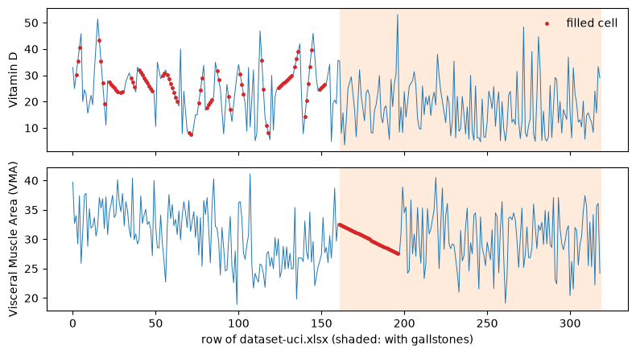

# gallstone_disease

> Generated from [`dataset.py`](dataset.py) by `dataset check` (or `build`). Do not edit this page: change `dataset.py` and re-run the check.

Binary classification of `Gallstone Status`, scored with `roc_auc` on IID splits. 242 rows and 37 features. Source: UCI (2025).

Built as `01a111fc-d8af-7a12-816b-905e5085bf7f` on 2026-10-06, but `dataset.py` has changed since: it now gives checksum `v2:e9bb897164e40d1d687137d25b237b247113915c3c9b62f9e2be3287cfcd1519`, so the build is stale. See [Build](#build).

## In brief

**Question.** Does an outpatient have gallstone disease?

**Use case.** An internal-medicine clinic screens outpatients for gallstone disease from a body-composition scan and routine blood tests, for example to decide who goes on to imaging (the source paper's aim is early prediction).

**One row.** One outpatient seen at the Internal Medicine Outpatient Clinic of Ankara VM Medical Park Hospital, Turkey, June 2022 to June 2023, who still had a gallbladder (the study left out 134 of 454 whose gallbladder had been removed); 242 of the 319 in the file, without those recorded through a second route.

**Predicted.** Whether the person was diagnosed with gallstone disease (coded 1; 86 of 242, about a third); how it was diagnosed is not stated.

**Known at prediction time.** Age, sex, other illnesses (coronary disease, hypothyroidism, diabetes), height and weight, body composition from bioimpedance (water, fat, muscle, bone, visceral fat), the fatty-liver grade from ultrasound, and blood tests (sugar, lipids, liver and kidney values, inflammation, haemoglobin, vitamin D).

**What the test data stands for.** Random people, so the test data stands for new patients of the same clinic and year.

> **Use case fit: approximate (a stand-in with a known gap).** The values are measured at the visit where the diagnosis is made, but the fatty-liver grade comes from the ultrasound that also finds gallstones, and the two groups were recorded apart: vitamin D for all with gallstones and half of the others, and most with gallstones through a second recording route (dropped here).

## Files in this folder

| file | what it is |
|---|---|
| [`dataset.py`](dataset.py) | The definition, and the only file edited by hand: metadata, reading and cleaning the raw files, feature types and splits. |
| [`explore.ipynb`](explore.ipynb) | The workbench for looking at the data (`ds = workbench()`), committed without outputs. Not needed to rebuild. |
| [`README.md`](README.md) | This page, generated by `dataset check` and `dataset build`. |
| [`figures/`](figures) | The figures of the decisions below, generated with this page. |

- The curation record, with the triage decision and its sources: [`curation/records/gallstone_disease.md`](../../../../curation/records/gallstone_disease.md)
- The original source: <https://archive.ics.uci.edu/dataset/1150/gallstone-1>
- The collection this folder belongs to: [`tabarena-v0pt2/README.md`](../README.md) and [`tabarena-v0pt2/CHANGELOG.md`](../CHANGELOG.md)

## Rebuild

`dataset.py` reads its raw files from `local-data-warehouse/gallstone_disease/`. To get them:

```text
We get the data from UCI.

wget https://archive.ics.uci.edu/static/public/1150/gallstone-1.zip && unzip gallstone-1.zip && rm gallstone-1.zip && unzip dataset-uci.zip && rm dataset-uci.zip && mkdir -p local-data-warehouse/gallstone_disease && mv dataset-uci.xlsx local-data-warehouse/gallstone_disease/
```

Then, from the repository root:

```bash
.venv/bin/python -m data_foundry.curation.cli dataset check datasets/_dev/tabarena-v0pt2/gallstone_disease   # pipeline and checks, no UUID; rewrites this page
.venv/bin/python -m data_foundry.curation.cli dataset build datasets/_dev/tabarena-v0pt2/gallstone_disease   # also saves the container and records its UUID
```

Only curators run `build`, when the dataset ships.

## Dataset and task

| field | value |
|---|---|
| source | UCI: https://archive.ics.uci.edu/dataset/1150/gallstone-1 |
| year | 2025 |
| domain | medical & healthcare |
| license | CC BY 4.0 |
| data_tags | IID |
| reference | esen2024early |
| rows x columns | 242 x 38 |
| task.target | Gallstone Status |
| task.problem_type | binary_classification |
| task.metric | roc_auc |
| task.split_regime | iid |
| task.stratify_on | Gallstone Status |

<details>
<summary>Feature types: 6 categorical, 0 string, 0 datetime</summary>

- categorical (6): `Coronary Artery Disease (CAD)`, `Hypothyroidism`, `Gender`, `Comorbidity`, `Diabetes Mellitus (DM)`, `Gallstone Status`
- string (0): none
- datetime (0): none

</details>

<details>
<summary>BibTeX</summary>

```bibtex
@article{esen2024early,
  title={Early prediction of gallstone disease with a machine learning-based method from bioimpedance and laboratory data},
  author={Esen, {\.I}rfan and Arslan, Hilal and Esen, Selin Akt{\"u}rk and G{\"u}l{\c{s}}en, Mervenur and K{\"u}ltekin, Nimet and {\"O}zdemir, O{\u{g}}uzhan},
  journal={Medicine},
  volume={103},
  number={8},
  pages={e37258},
  year={2024},
  publisher={LWW}
}
```

</details>

## Sample rows

The first 5 of 242 rows of the final frame (random rows: the frame is shuffled); 12 of 38 columns, the target first. Cells are cut at 40 characters.

| Gallstone Status | Age | Gender | Comorbidity | Coronary Artery Disease (CAD) | Hypothyroidism | Diabetes Mellitus (DM) | Height | Weight | Body Mass Index (BMI) | Total Body Water (TBW) | Extracellular Water (ECW) |
|---|---|---|---|---|---|---|---|---|---|---|---|
| 0 | 30 | 1 | 0 | 0 | 0 | 0 | 157 | 63.4 | 25.7 | 33.2 | 14 |
| 1 | 65 | 0 | 1 | 0 | 0 | 1 | 172 | 121 | 40.9 | 56.9 | 24.5 |
| 1 | 57 | 1 | 1 | 0 | 0 | 0 | 162 | 74.7 | 28.5 | 32.7 | 15.5 |
| 0 | 32 | 0 | 0 | 0 | 0 | 0 | 182 | 70 | 23.8 | 45.9 | 18.6 |
| 0 | 50 | 0 | 0 | 0 | 0 | 0 | 185 | 92.8 | 27.1 | 52.9 | 21.2 |

## Curation notes

We start with dataset-uci.xlsx from UCI: 319 outpatients, the 161 without gallstones first (rows 0-160), then the 158 with. 1 = gallstones, as in the paper; the UCI page has the coding reversed. We change what lets a model tell the groups apart for reasons other than gallstones, and document the rest. ROC AUC is for 3-fold x 20 random splits: on the UCI file TabPFN 3.5 reaches 0.913 and logistic regression 0.857; here TabPFN 3.5 0.838, gradient boosting 0.778, random forest 0.773 and logistic regression 0.762. The task probes flag `no_spread` (their untuned linear model, random forest and LightGBM reach 0.754-0.768), but methods spread: TabPFN 3.5 beats the other three by 0.06-0.08 on 92-93% of the splits.

- We drop 77 rows (72 with gallstones, 5 without) recorded through a second route: at least two of body-fat % at two decimals, extracellular and intracellular water in whole kilograms, ECF/TBW (extracellular share of body water) with decimals, and an obesity % that is not the BMI-based degree of obesity (decision table). Their ECF/TBW is lower although they are heavier, and models recognise them: with these rows, TabPFN 3.5 separates them from the people without gallstones at 0.993 and the other people with gallstones at 0.842, and gives the 5 recorded this way without gallstones a mean gallstone probability of 0.77 (0.22 for the others). They cannot be aligned with the other rows: only 5 people without gallstones were recorded this way.
- We drop hyperlipidemia: it is set for 8 with gallstones and nobody without, although total cholesterol of 240 mg/dL or more is as common (32 of 158 with, 35 of 161 without), so it was recorded for one group only.
- We write five columns at the precision of their measured values: GFR (kidney filtration rate) in whole numbers, vitamin D and visceral muscle area to one decimal, CRP and creatinine to two. GFR was written to two decimals for 80% of those without gallstones and 15% of those with, and the filled cells (next point) carry up to 8 decimals in one group only. The number format alone gives ROC AUC 0.947 on the UCI file and 0.557 here.
- Kept: 134 cells filled with straight lines between the rows above and below (figure), although the UCI page calls the file complete: vitamin D 77 (all without gallstones), visceral muscle area 35 (all with), GFR 13 (all with), CRP 6 and creatinine 3. They come from neighbours of the same group but do not carry the label: re-imputed from the other features inside each training fold, without the label, TabPFN 3.5 reaches 0.864 and logistic regression 0.744. Set to missing instead, the gaps would mark the groups, since they follow them: vitamin D was measured for all 86 with gallstones but only 79 of the 156 without.
- Kept: runs of round values that the same test flags in bone mass, ALT and glucose (could be chance) and in ECF/TBW (each equals the rounded 100 x ECW / TBW, so measured).
- Kept: the fatty-liver grade (hepatic fat accumulation), which the paper grades on the ultrasound that also finds gallstones. Without it TabPFN 3.5 reaches 0.834, logistic regression 0.763.
- Kept: data-entry errors such as GFR 11.34 in row 117 (the CKD-EPI 2021 equation gives 111.34), triglyceride 1.39 in row 127 and total body water that is not extracellular + intracellular water in rows 168, 178 and 300. CRP is exactly 0 for 58% of those without gallstones and 28% of those with; both groups also have small nonzero values, so these are low values, not a recording habit.
- The rows are sorted by class and, among those without gallstones, by sex; the base class shuffles them.

## Splits

Default splits.

20 repeat(s) x 3 fold(s) with seed 4267; train 161 to 162 rows, test 80 to 81 rows.

<details>
<summary>Show all 60 splits</summary>

| repeat | fold | n_train | n_test |
|---|---|---|---|
| 0 | 0 | 161 | 81 |
| 0 | 1 | 161 | 81 |
| 0 | 2 | 162 | 80 |
| 1 | 0 | 161 | 81 |
| 1 | 1 | 161 | 81 |
| 1 | 2 | 162 | 80 |
| 2 | 0 | 161 | 81 |
| 2 | 1 | 161 | 81 |
| 2 | 2 | 162 | 80 |
| 3 | 0 | 161 | 81 |
| 3 | 1 | 161 | 81 |
| 3 | 2 | 162 | 80 |
| 4 | 0 | 161 | 81 |
| 4 | 1 | 161 | 81 |
| 4 | 2 | 162 | 80 |
| 5 | 0 | 161 | 81 |
| 5 | 1 | 161 | 81 |
| 5 | 2 | 162 | 80 |
| 6 | 0 | 161 | 81 |
| 6 | 1 | 161 | 81 |
| 6 | 2 | 162 | 80 |
| 7 | 0 | 161 | 81 |
| 7 | 1 | 161 | 81 |
| 7 | 2 | 162 | 80 |
| 8 | 0 | 161 | 81 |
| 8 | 1 | 161 | 81 |
| 8 | 2 | 162 | 80 |
| 9 | 0 | 161 | 81 |
| 9 | 1 | 161 | 81 |
| 9 | 2 | 162 | 80 |
| 10 | 0 | 161 | 81 |
| 10 | 1 | 161 | 81 |
| 10 | 2 | 162 | 80 |
| 11 | 0 | 161 | 81 |
| 11 | 1 | 161 | 81 |
| 11 | 2 | 162 | 80 |
| 12 | 0 | 161 | 81 |
| 12 | 1 | 161 | 81 |
| 12 | 2 | 162 | 80 |
| 13 | 0 | 161 | 81 |
| 13 | 1 | 161 | 81 |
| 13 | 2 | 162 | 80 |
| 14 | 0 | 161 | 81 |
| 14 | 1 | 161 | 81 |
| 14 | 2 | 162 | 80 |
| 15 | 0 | 161 | 81 |
| 15 | 1 | 161 | 81 |
| 15 | 2 | 162 | 80 |
| 16 | 0 | 161 | 81 |
| 16 | 1 | 161 | 81 |
| 16 | 2 | 162 | 80 |
| 17 | 0 | 161 | 81 |
| 17 | 1 | 161 | 81 |
| 17 | 2 | 162 | 80 |
| 18 | 0 | 161 | 81 |
| 18 | 1 | 161 | 81 |
| 18 | 2 | 162 | 80 |
| 19 | 0 | 161 | 81 |
| 19 | 1 | 161 | 81 |
| 19 | 2 | 162 | 80 |

</details>

## Decisions

### 1. A second recording route: 77 rows dropped

Share of rows with each way of writing the body-composition values, by group; rows with at least two of the four form the second route.

| index | other rows, with gallstones | other rows, without gallstones | second route, with gallstones | second route, without gallstones |
|---|---|---|---|---|
| body fat % at two decimals | 0 | 0 | 0.9 | 0.6 |
| water in whole kg | 0.01 | 0 | 1 | 1 |
| ECF/TBW with decimals | 0.02 | 0 | 0.9 | 1 |
| obesity % not from BMI | 0.02 | 0.01 | 0.99 | 1 |
| ECF/TBW median | 43.5 | 42 | 39.5 | 40.8 |
| BMI median | 28.2 | 27.8 | 29.9 | 25.7 |
| rows | 86 | 156 | 72 | 5 |

### 2. Cells filled from the neighbouring rows: kept

Vitamin D and visceral muscle area along the file; the filled cells lie on straight lines between their neighbours.



## Bundle checks

0 error(s), 0 warning(s), 0 info (26 checks run, plus the dataset's own checks).


## Data checks

### Feature summary

<details>
<summary>Show the table (38 rows)</summary>

| index | dtype | n_missing | pct_missing | n_unique | examples |
|---|---|---|---|---|---|
| Gallstone Status | category | 0 | 0 | 2 | 0, 1 |
| Gender | category | 0 | 0 | 2 | 0, 1 |
| Comorbidity | category | 0 | 0 | 4 | 0, 1, 3, 2 |
| Coronary Artery Disease (CAD) | category | 0 | 0 | 2 | 0, 1 |
| Hypothyroidism | category | 0 | 0 | 2 | 0, 1 |
| Diabetes Mellitus (DM) | category | 0 | 0 | 2 | 0, 1 |
| Weight | float64 | 0 | 0 | 193 | 68.4, 63.6, 76.8, 70.6, 68.2, 78.4, 102.2, 72.8, 96.6, 48.9 |
| Body Mass Index (BMI) | float64 | 0 | 0 | 139 | 28.2, 25.3, 31.5, 24.4, 28.3, 25.1, 25.2, 22.2, 30.8, 29.9 |
| Total Body Water (TBW) | float64 | 0 | 0 | 169 | 36.2, 43.5, 41.8, 36.5, 29.5, 43.2, 37.1, 39.8, 35.1, 43.0 |
| Extracellular Water (ECW) | float64 | 0 | 0 | 105 | 17.1, 15.5, 18.1, 16.9, 16.6, 15.7, 18.9, 21.2, 20.3, 16.2 |
| Intracellular Water (ICW) | float64 | 0 | 0 | 130 | 19.2, 23.0, 25.6, 18.1, 23.9, 18.9, 28.2, 17.0, 22.9, 24.5 |
| Extracellular Fluid/Total Body Water (ECF/TBW) | float64 | 0 | 0 | 15 | 42.0, 43.0, 41.0, 40.0, 44.0, 46.0, 45.0, 47.0, 48.0, 39.0 |
| Total Body Fat Ratio (TBFR) (%) | float64 | 0 | 0 | 159 | 19.2, 19.7, 34.2, 23.6, 31.6, 24.3, 36.9, 31.9, 33.4, 18.0 |
| Lean Mass (LM) (%) | float64 | 0 | 0 | 226 | 76.4, 64.84, 78.55, 82.06, 80.24, 75.7, 71.95, 65.87, 64.03, 80.94 |
| Body Protein Content (Protein) (%) | float64 | 0 | 0 | 206 | 17.1, 13.45, 14.2, 13.95, 16.48, 14.9, 15.49, 14.7, 14.97, 14.99 |
| Bone Mass (BM) | float64 | 0 | 0 | 22 | 2.6, 3.0, 3.1, 2.4, 3.4, 2.8, 2.2, 3.3, 2.5, 3.2 |
| Muscle Mass (MM) | float64 | 0 | 0 | 181 | 68.2, 56.8, 65.4, 43.9, 49.6, 58.1, 41.8, 57.4, 43.5, 57.5 |
| Obesity (%) | float64 | 0 | 0 | 201 | 13.2, 15.1, 6.8, 36.0, 49.5, 40.1, 0.4, 32.6, 15.3, 13.7 |
| Total Fat Content (TFC) | float64 | 0 | 0 | 172 | 24.2, 20.1, 23.8, 17.1, 23.4, 15.6, 30.8, 28.9, 10.7, 27.6 |
| Visceral Fat Area (VFA) | float64 | 0 | 0 | 140 | 9.1, 8.2, 12.6, 10.6, 14.5, 9.0, 9.5, 8.0, 10.1, 10.4 |
| Visceral Muscle Area (VMA) (Kg) | float64 | 0 | 0 | 135 | 32.3, 33.7, 37.1, 32.0, 30.9, 31.7, 29.2, 28.6, 30.3, 32.2 |
| Glucose | float64 | 0 | 0 | 69 | 91.0, 99.0, 89.0, 93.0, 94.0, 103.0, 97.0, 92.0, 96.0, 95.0 |
| Total Cholesterol (TC) | float64 | 0 | 0 | 133 | 206.0, 185.0, 172.0, 183.0, 187.0, 173.0, 174.0, 212.0, 194.0, 240.0 |
| Low Density Lipoprotein (LDL) | float64 | 0 | 0 | 120 | 122.0, 127.0, 105.0, 167.0, 94.0, 129.0, 131.0, 115.0, 143.0, 152.0 |
| High Density Lipoprotein (HDL) | float64 | 0 | 0 | 61 | 40.0, 50.0, 54.0, 42.0, 46.0, 45.0, 47.0, 33.0, 48.0, 43.0 |
| Triglyceride | float64 | 0 | 0 | 153 | 105.0, 128.0, 78.0, 97.0, 63.0, 132.0, 103.0, 71.0, 216.0, 115.0 |
| Aspartat Aminotransferaz (AST) | float64 | 0 | 0 | 40 | 16.0, 17.0, 14.0, 19.0, 21.0, 22.0, 13.0, 18.0, 15.0, 20.0 |
| Alanin Aminotransferaz (ALT) | float64 | 0 | 0 | 61 | 13.0, 16.0, 18.0, 14.0, 19.0, 12.0, 15.0, 20.0, 27.0, 17.0 |
| Alkaline Phosphatase (ALP) | float64 | 0 | 0 | 85 | 51.0, 49.0, 63.0, 69.0, 70.0, 66.0, 58.0, 73.0, 79.0, 60.0 |
| Creatinine | float64 | 0 | 0 | 69 | 0.6, 0.7, 0.86, 0.59, 0.64, 0.81, 0.72, 0.96, 0.82, 0.66 |
| Glomerular Filtration Rate (GFR) | float64 | 0 | 0 | 64 | 107.0, 108.0, 105.0, 102.0, 114.0, 104.0, 109.0, 106.0, 98.0, 96.0 |
| C-Reactive Protein (CRP) | float64 | 0 | 0 | 89 | 0.0, 0.5, 0.08, 0.26, 0.9, 0.8, 0.55, 0.6, 2.4, 0.4 |
| Hemoglobin (HGB) | float64 | 0 | 0 | 75 | 14.4, 13.5, 15.6, 16.0, 12.9, 15.9, 15.5, 15.4, 14.9, 13.8 |
| Vitamin D | float64 | 0 | 0 | 164 | 30.0, 26.9, 20.0, 24.0, 28.0, 15.0, 19.4, 8.7, 15.7, 25.0 |
| Age | int64 | 0 | 0 | 55 | 53, 59, 56, 51, 38, 44, 50, 43, 37, 34 |
| Height | int64 | 0 | 0 | 43 | 170, 175, 176, 172, 168, 178, 158, 160, 163, 165 |
| Visceral Fat Rating (VFR) | int64 | 0 | 0 | 22 | 9, 12, 8, 7, 11, 6, 10, 5, 3, 4 |
| Hepatic Fat Accumulation (HFA) | int64 | 0 | 0 | 5 | 0, 2, 1, 3, 4 |

</details>

### Target distribution

| Gallstone Status | count | pct |
|---|---|---|
| 0 | 156 | 64.46 |
| 1 | 86 | 35.54 |

### Numeric features

<details>
<summary>Show the table (32 rows)</summary>

| index | count | mean | std | min | max |
|---|---|---|---|---|---|
| Age | 242 | 47.6446 | 12.7464 | 20 | 96 |
| Height | 242 | 167.302 | 10.023 | 145 | 191 |
| Weight | 242 | 79.6905 | 15.8047 | 47.3 | 143.5 |
| Body Mass Index (BMI) | 242 | 28.493 | 5.18085 | 17.4 | 49.7 |
| Total Body Water (TBW) | 242 | 40.7616 | 8.01464 | 13 | 66.2 |
| Extracellular Water (ECW) | 242 | 17.507 | 2.87972 | 11.2 | 27.8 |
| Intracellular Water (ICW) | 242 | 23.4066 | 5.60827 | 13.8 | 57.1 |
| Extracellular Fluid/Total Body Water (ECF/TBW) | 242 | 43.2248 | 2.4729 | 39 | 52 |
| Total Body Fat Ratio (TBFR) (%) | 242 | 27.6698 | 8.34218 | 6.3 | 49.8 |
| Lean Mass (LM) (%) | 242 | 72.276 | 8.3152 | 50.25 | 93.67 |
| Body Protein Content (Protein) (%) | 242 | 15.7338 | 2.03466 | 5.56 | 21.72 |
| Visceral Fat Rating (VFR) | 242 | 8.97934 | 4.52604 | 1 | 31 |
| Bone Mass (BM) | 242 | 2.86446 | 0.506941 | 1.9 | 4 |
| Muscle Mass (MM) | 242 | 54.1095 | 10.8247 | 4.7 | 78.8 |
| Obesity (%) | 242 | 31.0156 | 21.4606 | 0.4 | 125.6 |
| Total Fat Content (TFC) | 242 | 22.6211 | 9.37848 | 3.1 | 60.7 |
| Visceral Fat Area (VFA) | 242 | 11.7864 | 5.2456 | 0.9 | 41 |
| Visceral Muscle Area (VMA) (Kg) | 242 | 30.3157 | 4.49657 | 18.9 | 41.1 |
| Hepatic Fat Accumulation (HFA) | 242 | 1.09917 | 1.06942 | 0 | 4 |
| Glucose | 242 | 107.164 | 41.9607 | 69 | 575 |
| Total Cholesterol (TC) | 242 | 204.285 | 45.1558 | 60 | 360 |
| Low Density Lipoprotein (LDL) | 242 | 128.542 | 37.5201 | 28 | 293 |
| High Density Lipoprotein (HDL) | 242 | 48.9161 | 19.0312 | 25 | 273 |
| Triglyceride | 242 | 144.224 | 94.3826 | 1.39 | 692 |
| Aspartat Aminotransferaz (AST) | 242 | 22.0103 | 14.9336 | 8 | 162 |
| Alanin Aminotransferaz (ALT) | 242 | 26.0372 | 21.308 | 3 | 205 |
| Alkaline Phosphatase (ALP) | 242 | 71.3963 | 22.9369 | 7 | 157 |
| Creatinine | 242 | 0.800826 | 0.17733 | 0.49 | 1.46 |
| Glomerular Filtration Rate (GFR) | 242 | 102.045 | 15.4976 | 11 | 129 |
| C-Reactive Protein (CRP) | 242 | 1.2507 | 4.36375 | 0 | 43.4 |
| Hemoglobin (HGB) | 242 | 14.5054 | 1.75873 | 8.5 | 18.8 |
| Vitamin D | 242 | 23.0818 | 9.53927 | 3.5 | 53.1 |

</details>

### Categorical features

<details>
<summary>Show the table (14 rows)</summary>

| column | rank | value | count | pct |
|---|---|---|---|---|
| Comorbidity | 1 | 0 | 156 | 64.46 |
| Comorbidity | 2 | 1 | 83 | 34.3 |
| Comorbidity | 3 | 3 | 2 | 0.83 |
| Comorbidity | 4 | 2 | 1 | 0.41 |
| Coronary Artery Disease (CAD) | 1 | 0 | 231 | 95.45 |
| Coronary Artery Disease (CAD) | 2 | 1 | 11 | 4.55 |
| Diabetes Mellitus (DM) | 1 | 0 | 210 | 86.78 |
| Diabetes Mellitus (DM) | 2 | 1 | 32 | 13.22 |
| Gallstone Status | 1 | 0 | 156 | 64.46 |
| Gallstone Status | 2 | 1 | 86 | 35.54 |
| Gender | 1 | 0 | 128 | 52.89 |
| Gender | 2 | 1 | 114 | 47.11 |
| Hypothyroidism | 1 | 0 | 235 | 97.11 |
| Hypothyroidism | 2 | 1 | 7 | 2.89 |

</details>

## Build

| field | value |
|---|---|
| uuid | 01a111fc-d8af-7a12-816b-905e5085bf7f |
| checksum | v2:087c399da17c83e68663c6f18d35bedf6a650bb478ce9752985712430fe71520 |
| built_at | 2026-10-06T16:12:25+00:00 |
| path | gallstone_disease/01a111fc-d8af-7a12-816b-905e5085bf7f |
| data_foundry_version | 0.0.5 |
| git_sha | 8fbc4745ab8de19d5bc0c98a89b008f5d779909f-dirty |
| libraries | {'python': '3.11.14', 'pandas': '2.3.3', 'numpy': '2.1.3', 'pyarrow': '20.0.0', 'scikit-learn': '1.7.2', 'polars': '1.41.1'} |
| stale | yes: the definition now gives checksum `v2:e9bb897164e40d1d687137d25b237b247113915c3c9b62f9e2be3287cfcd1519` |
