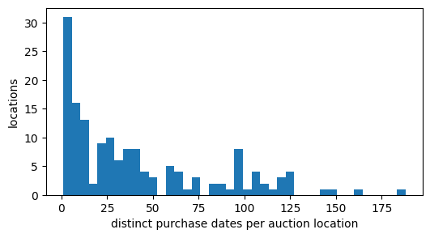

# kick

> Generated from [`dataset.py`](dataset.py) by `dataset check` (or `build`). Do not edit this page: change `dataset.py` and re-run the check.

Binary classification of `IsBadBuy`, scored with `roc_auc` on temporal splits by `PurchDate`. 72,983 rows and 28 features. Source: Kaggle (2011).

Built as `01a111fc-8ab4-7b2f-9955-2cc583c9e979` on 2026-10-06, but `dataset.py` has changed since: it now gives checksum `v2:c6d54e7749c774e40077f06f93d43810dc3afc6a554004bfd0927911031ea206`, so the build is stale. See [Build](#build).

## In brief

**Question.** Is a used car bought at auction a "kick", a purchase with serious problems?

**Use case.** A used-car dealer decides at the auction whether to buy a car, avoiding cars that would have to be returned or resold at a loss.

**One row.** One car bought at a US auction in 2009-2010.

**Predicted.** Whether the purchase turned out to be a bad buy.

**Known at prediction time.** The car (age, make, model, trim, mileage, colour), its auction and retail price guides, the purchase price, the auction, the buyer and the warranty cost.

**What the test data stands for.** The test data is the most recent purchases, in nine windows of purchase dates, with every earlier purchase for training.

**Our changes to the source.** We split by purchase date instead of the competition's random split, in which both sides cover the same two years.

> **Use case fit: direct (the rows, features and split mirror the use case).** The cars, the features known at the auction and the split by purchase date mirror the dealer's decision. Four fields that were filled in after the outcome (WheelType, WheelTypeID, PRIMEUNIT, AUCGUART) are dropped.

## Files in this folder

| file | what it is |
|---|---|
| [`dataset.py`](dataset.py) | The definition, and the only file edited by hand: metadata, reading and cleaning the raw files, feature types and splits. |
| [`README.md`](README.md) | This page, generated by `dataset check` and `dataset build`. |
| [`figures/`](figures) | The figures of the decisions below, generated with this page. |

- The curation record, with the triage decision and its sources: [`curation/records/kick.md`](../../../../curation/records/kick.md)
- The original source: <https://www.kaggle.com/competitions/DontGetKicked/overview>
- The collection this folder belongs to: [`tabarena-v0pt2/README.md`](../README.md) and [`tabarena-v0pt2/CHANGELOG.md`](../CHANGELOG.md)

## Rebuild

`dataset.py` reads its raw files from `local-data-warehouse/kick/`. To get them:

```text
kaggle competitions download -c dontgetkicked -p local-data-warehouse/kick
unzip local-data-warehouse/kick/dontgetkicked.zip -d local-data-warehouse/kick/
rm local-data-warehouse/kick/dontgetkicked.zip
```

Then, from the repository root:

```bash
.venv/bin/python -m data_foundry.curation.cli dataset check datasets/_dev/tabarena-v0pt2/kick   # pipeline and checks, no UUID; rewrites this page
.venv/bin/python -m data_foundry.curation.cli dataset build datasets/_dev/tabarena-v0pt2/kick   # also saves the container and records its UUID
```

Only curators run `build`, when the dataset ships.

## Dataset and task

| field | value |
|---|---|
| source | Kaggle: https://www.kaggle.com/competitions/DontGetKicked/overview |
| year | 2011 |
| domain | business & marketing |
| license | Public Domain |
| data_tags | Non-IID, Temporal |
| reference | DontGetKicked |
| rows x columns | 72,983 x 29 |
| task.target | IsBadBuy |
| task.problem_type | binary_classification |
| task.metric | roc_auc |
| task.split_regime | temporal_non_iid |
| task.stratify_on | IsBadBuy |
| task.time_on | PurchDate |

**Metric**

| field | value |
|---|---|
| name | `roc_auc` (standard; takes proba; higher is better) |
| origin | source: the source's metric |
| original | Gini index (Kaggle normalized Gini) |
| reference | https://www.kaggle.com/competitions/DontGetKicked/overview/evaluation |
| definition | Normalized Gini = 2 x ROC AUC - 1 for a binary target; ranks models identically to ROC AUC. |

<details>
<summary>Feature types: 15 categorical, 0 string, 1 datetime</summary>

- categorical (15): `BYRNO`, `VNZIP1`, `Trim`, `SubModel`, `Color`, `Transmission`, `Nationality`, `Size`, `TopThreeAmericanName`, `Auction`, `Make`, `Model`, `VNST`, `IsBadBuy`, `IsOnlineSale`
- string (0): none
- datetime (1): `PurchDate`

</details>

<details>
<summary>BibTeX</summary>

```bibtex
@misc{DontGetKicked,
    author = {faysal and Will Adams and Will Cukierski},
    title = {Don't Get Kicked!},
    year = {2011},
    howpublished = {\url{https://kaggle.com/competitions/DontGetKicked}},
    note = {Kaggle}
}
```

</details>

## Sample rows

The first 5 of 72,983 rows of the final frame (the oldest rows: the frame is sorted by `PurchDate`); 12 of 29 columns, the target first. Cells are cut at 40 characters.

| IsBadBuy | PurchDate | Auction | VehYear | VehicleAge | Make | Model | Trim | SubModel | Color | Transmission | VehOdo |
|---|---|---|---|---|---|---|---|---|---|---|---|
| 1 | 2009-01-05 00:00:00 | MANHEIM | 2006 | 3 | FORD | FREESTYLE AWD V6 3.0 | SE | 4D CUV 3.0L SE | GREEN | AUTO | 72672 |
| 0 | 2009-01-05 00:00:00 | MANHEIM | 2003 | 6 | CHEVROLET | 1500 SILVERADO PICKU | W/T | EXT CAB 5.3L LS | SILVER | AUTO | 73099 |
| 0 | 2009-01-05 00:00:00 | MANHEIM | 2004 | 5 | CHEVROLET | IMPALA 3.4L V6 SFI | Bas | 4D SEDAN | WHITE | AUTO | 88286 |
| 0 | 2009-01-05 00:00:00 | MANHEIM | 2003 | 6 | ISUZU | AXIOM 4WD V6 3.5L V6 | S | 4D SPORT UTILITY S | BLUE | AUTO | 90614 |
| 0 | 2009-01-05 00:00:00 | MANHEIM | 2006 | 3 | CHEVROLET | IMPALA 3.5L V6 SFI | LS | 4D SEDAN LS | BLUE | AUTO | 78113 |

## Curation notes

- The data is from a Kaggle competition. Its train/test split is neither temporal nor grouped: both cover January 2009 to December 2010 (test is 36-44% of every quarter), and 78.9% of test rows are at an auction location ("Auction" + "VNZIP1") that also occurs in train (72 of 128 test locations); some locations are only in test.
- The data is temporal and also grouped by auction location. Locations reappear over time, so a grouped split would test unseen auctions, which does not match deployment; a model is deployed on future purchases at mostly known auctions. Therefore, we use temporal evaluation.
- The test features from the Kaggle competition are available and could be used for unsupervised approaches.
- We transform "PurchDate" to datetime.
- We drop the "RefId" column, as it is just an identifier and not useful for modeling.
- We assign the categorical features "BYRNO" and "VNZIP1" to category dtype, as they are given as numbers.
- Leak, dropped (LEAK-10; Lennart, 2026-10-22, consistent with expresso_churn_prediction's REGION): "WheelType" and "WheelTypeID" were most likely filled in after the outcome. WheelType is missing for 24.9% of bad buys and 1.5% of good ones, in every band of vehicle age, odometer and price; a model of the missingness from the auction covariates, fit on good buys, predicts 1.2% missing for the bad buys; within auction and purchase date the missing flag alone still separates bad buys (ROC AUC 0.572), while the missing flags of the other columns stay at 0.49-0.54. Its whole value is the flag: LightGBM on the 9 temporal windows (300 trees, mean ROC AUC) 0.750 with the columns, 0.677 without.
- Leak, dropped (LEAK-10; same decision): "PRIMEUNIT" and "AUCGUART" (filled on the same rows, about 95% missing). From October 2010 they are filled for 32.7% of good buys and 7.8% of bad ones; a model of the fill from the auction covariates, fit on good buys, predicts 42.3% filled for the bad buys; within auction and purchase date the flag gives ROC AUC 0.632. These months fall in the last test windows.
- The host's test file carries all four fields the same way (WheelType missing for 4.5% of the Kaggle test rows against 4.3% of train; PRIMEUNIT filled for 46.0% in December 2010), so the competition's task had them. We drop them anyway because that test file is a holdout from the same snapshot, taken after the outcomes; at a real auction no car has been kicked back yet. If the recording process is ever documented as known at the auction, they can come back.

## Splits

Expanding-window temporal splits: 9 test window(s) of 28 time values, walking back from the newest data, newest first; train is all earlier data.

9 repeat(s) x 1 fold(s) with seed 4267; train 35,514 to 69,278 rows, test 3,605 to 5,164 rows. Prediction horizon: 28 days.

| repeat | fold | n_train | n_test | train_start | train_end | test_start | test_end |
|---|---|---|---|---|---|---|---|
| 0 | 0 | 69278 | 3705 | 2009-01-05 00:00:00 | 2010-11-22 00:00:00 | 2010-11-23 00:00:00 | 2010-12-30 00:00:00 |
| 1 | 0 | 64114 | 5164 | 2009-01-05 00:00:00 | 2010-10-13 00:00:00 | 2010-10-14 00:00:00 | 2010-11-22 00:00:00 |
| 2 | 0 | 59754 | 4360 | 2009-01-05 00:00:00 | 2010-09-03 00:00:00 | 2010-09-06 00:00:00 | 2010-10-13 00:00:00 |
| 3 | 0 | 56149 | 3605 | 2009-01-05 00:00:00 | 2010-07-27 00:00:00 | 2010-07-28 00:00:00 | 2010-09-03 00:00:00 |
| 4 | 0 | 52221 | 3928 | 2009-01-05 00:00:00 | 2010-06-17 00:00:00 | 2010-06-18 00:00:00 | 2010-07-27 00:00:00 |
| 5 | 0 | 47942 | 4279 | 2009-01-05 00:00:00 | 2010-05-07 00:00:00 | 2010-05-10 00:00:00 | 2010-06-17 00:00:00 |
| 6 | 0 | 43980 | 3962 | 2009-01-05 00:00:00 | 2010-03-30 00:00:00 | 2010-03-31 00:00:00 | 2010-05-07 00:00:00 |
| 7 | 0 | 40008 | 3972 | 2009-01-05 00:00:00 | 2010-02-19 00:00:00 | 2010-02-20 00:00:00 | 2010-03-30 00:00:00 |
| 8 | 0 | 35514 | 4494 | 2009-01-05 00:00:00 | 2010-01-12 00:00:00 | 2010-01-13 00:00:00 | 2010-02-19 00:00:00 |

## Decisions

### 1. The competition's split is neither temporal nor grouped

The Kaggle train and test files cover the same two years, and most test rows are at an auction location that is also in train, so we do not reuse that split.

| index | value |
|---|---|
| train purchase dates | 2009-01-05 to 2010-12-30 |
| test purchase dates | 2009-01-05 to 2010-12-31 |
| auction locations in train / test / both | 155 / 128 / 72 |
| test rows at a location also in train | 78.9% |

### 2. Temporal split, not grouped by auction location

Auction locations (auction and ZIP code) reappear over time, so a grouped split would not match deployment; a model is deployed on future purchases.

| index | value |
|---|---|
| auction locations | 155 |
| seen on more than one date | 140 |
| rows at a location seen on more than one date | 99.9% |

### 3. Auction locations recur across the whole period

Most locations are seen on many purchase dates, so there is no clean set of unseen locations.



## Bundle checks

0 error(s), 0 warning(s), 1 info (26 checks run, plus the dataset's own checks).

- **info** `dataset_duplicate_rows`: 1 exact duplicate row(s) (0.0% of the data). (hint: Duplicates spread across train and test inflate scores — deduplicate unless the repetition is meaningful.)

## Data checks

### Feature summary

<details>
<summary>Show the table (29 rows)</summary>

| index | dtype | n_missing | pct_missing | n_unique | examples |
|---|---|---|---|---|---|
| Trim | category | 2360 | 3.23 | 134 | Bas, LS, SE, SXT, LT, LX, Tou, EX, SEL, XLT |
| SubModel | category | 8 | 0.01 | 863 | 4D SEDAN, 4D SEDAN LS, 4D SEDAN SE, 4D WAGON, MINIVAN 3.3L, 4D SUV 4.2L LS, 4D … |
| Color | category | 8 | 0.01 | 16 | SILVER, WHITE, BLUE, GREY, BLACK, RED, GOLD, GREEN, MAROON, BEIGE |
| Transmission | category | 9 | 0.01 | 3 | AUTO, MANUAL, Manual |
| Nationality | category | 5 | 0.01 | 4 | AMERICAN, OTHER ASIAN, TOP LINE ASIAN, OTHER |
| Size | category | 5 | 0.01 | 12 | MEDIUM, LARGE, MEDIUM SUV, COMPACT, VAN, LARGE TRUCK, SMALL SUV, SPECIALTY, CRO… |
| TopThreeAmericanName | category | 5 | 0.01 | 4 | GM, CHRYSLER, FORD, OTHER |
| IsBadBuy | category | 0 | 0 | 2 | 0, 1 |
| Auction | category | 0 | 0 | 3 | MANHEIM, OTHER, ADESA |
| Make | category | 0 | 0 | 33 | CHEVROLET, DODGE, FORD, CHRYSLER, PONTIAC, KIA, SATURN, NISSAN, HYUNDAI, JEEP |
| Model | category | 0 | 0 | 1063 | PT CRUISER, IMPALA, TAURUS, CALIBER, CARAVAN GRAND FWD V6, MALIBU 4C, TAURUS 3.… |
| BYRNO | category | 0 | 0 | 74 | 99761, 18880, 835, 3453, 22916, 21053, 19619, 99750, 17675, 20928 |
| VNZIP1 | category | 0 | 0 | 153 | 32824, 27542, 75236, 74135, 80022, 85226, 85040, 29697, 95673, 28273 |
| VNST | category | 0 | 0 | 37 | TX, FL, CA, NC, AZ, CO, SC, OK, GA, TN |
| IsOnlineSale | category | 0 | 0 | 2 | 0, 1 |
| PurchDate | datetime64\[ns\] | 0 | 0 | 517 | 2010-11-23 00:00:00, 2009-02-25 00:00:00, 2010-12-08 00:00:00, 2010-10-13 00:00… |
| MMRCurrentAuctionAveragePrice | float64 | 315 | 0.43 | 10315 | 0.0, 5480.0, 5569.0, 6311.0, 8186.0, 7269.0, 6858.0, 7644.0, 8196.0, 8033.0 |
| MMRCurrentAuctionCleanPrice | float64 | 315 | 0.43 | 11265 | 0.0, 6461.0, 6584.0, 7450.0, 8107.0, 1.0, 8892.0, 9279.0, 7898.0, 9044.0 |
| MMRCurrentRetailAveragePrice | float64 | 315 | 0.43 | 12493 | 0.0, 6418.0, 6515.0, 7316.0, 7907.0, 11674.0, 8756.0, 9352.0, 10834.0, 5439.0 |
| MMRCurrentRetailCleanPrice | float64 | 315 | 0.43 | 13192 | 0.0, 7478.0, 7611.0, 8546.0, 9256.0, 10103.0, 10268.0, 12864.0, 11413.0, 12387.0 |
| MMRAcquisitionAuctionAveragePrice | float64 | 18 | 0.02 | 10342 | 0.0, 5480.0, 5569.0, 6311.0, 6858.0, 7644.0, 4573.0, 8196.0, 6892.0, 7048.0 |
| MMRAcquisitionAuctionCleanPrice | float64 | 18 | 0.02 | 11379 | 0.0, 6461.0, 6584.0, 7450.0, 8107.0, 1.0, 8892.0, 9044.0, 5967.0, 7614.0 |
| MMRAcquisitionRetailAveragePrice | float64 | 18 | 0.02 | 12725 | 0.0, 6418.0, 6515.0, 7316.0, 7907.0, 8756.0, 9352.0, 5439.0, 11114.0, 7943.0 |
| MMRAcquisitonRetailCleanPrice | float64 | 18 | 0.02 | 13456 | 0.0, 7478.0, 7611.0, 8546.0, 9256.0, 10103.0, 10268.0, 6944.0, 11562.0, 9613.0 |
| VehBCost | float64 | 0 | 0 | 2072 | 7500.0, 6500.0, 7200.0, 6000.0, 4200.0, 7000.0, 8000.0, 7800.0, 7100.0, 7400.0 |
| VehYear | int64 | 0 | 0 | 10 | 2006, 2005, 2007, 2004, 2008, 2003, 2002, 2001, 2009, 2010 |
| VehicleAge | int64 | 0 | 0 | 10 | 4, 3, 5, 2, 6, 7, 1, 8, 9, 0 |
| VehOdo | int64 | 0 | 0 | 39947 | 77995, 75009, 75371, 71225, 67464, 79015, 71762, 75530, 71823, 79215 |
| WarrantyCost | int64 | 0 | 0 | 281 | 920, 1974, 2152, 1389, 1215, 1155, 803, 728, 1503, 1086 |

</details>

### Target distribution

| IsBadBuy | count | pct |
|---|---|---|
| 0 | 64007 | 87.7 |
| 1 | 8976 | 12.3 |

### Numeric features

<details>
<summary>Show the table (13 rows)</summary>

| index | count | mean | std | min | max |
|---|---|---|---|---|---|
| VehYear | 72983 | 2005.34 | 1.73125 | 2001 | 2010 |
| VehicleAge | 72983 | 4.17664 | 1.71221 | 0 | 9 |
| VehOdo | 72983 | 71500 | 14578.9 | 4825 | 115717 |
| MMRAcquisitionAuctionAveragePrice | 72965 | 6128.91 | 2461.99 | 0 | 35722 |
| MMRAcquisitionAuctionCleanPrice | 72965 | 7373.64 | 2722.49 | 0 | 36859 |
| MMRAcquisitionRetailAveragePrice | 72965 | 8497.03 | 3156.29 | 0 | 39080 |
| MMRAcquisitonRetailCleanPrice | 72965 | 9850.93 | 3385.79 | 0 | 41482 |
| MMRCurrentAuctionAveragePrice | 72668 | 6132.08 | 2434.57 | 0 | 35722 |
| MMRCurrentAuctionCleanPrice | 72668 | 7390.68 | 2686.25 | 0 | 36859 |
| MMRCurrentRetailAveragePrice | 72668 | 8775.72 | 3090.7 | 0 | 39080 |
| MMRCurrentRetailCleanPrice | 72668 | 10145.4 | 3310.25 | 0 | 41062 |
| VehBCost | 72983 | 6730.93 | 1767.85 | 1 | 45469 |
| WarrantyCost | 72983 | 1276.58 | 598.847 | 462 | 7498 |

</details>

### Categorical features

<details>
<summary>Show the table (71 rows)</summary>

| column | rank | value | count | pct |
|---|---|---|---|---|
| Auction | 1 | MANHEIM | 41043 | 56.24 |
| Auction | 2 | OTHER | 17501 | 23.98 |
| Auction | 3 | ADESA | 14439 | 19.78 |
| BYRNO | 1 | 99761 | 3943 | 5.4 |
| BYRNO | 2 | 18880 | 3588 | 4.92 |
| BYRNO | 3 | 835 | 2987 | 4.09 |
| BYRNO | 4 | 3453 | 2927 | 4.01 |
| BYRNO | 5 | 22916 | 2852 | 3.91 |
| Color | 1 | SILVER | 14875 | 20.38 |
| Color | 2 | WHITE | 12123 | 16.61 |
| Color | 3 | BLUE | 10347 | 14.18 |
| Color | 4 | GREY | 7887 | 10.81 |
| Color | 5 | BLACK | 7627 | 10.45 |
| IsBadBuy | 1 | 0 | 64007 | 87.7 |
| IsBadBuy | 2 | 1 | 8976 | 12.3 |
| IsOnlineSale | 1 | 0 | 71138 | 97.47 |
| IsOnlineSale | 2 | 1 | 1845 | 2.53 |
| Make | 1 | CHEVROLET | 17248 | 23.63 |
| Make | 2 | DODGE | 12912 | 17.69 |
| Make | 3 | FORD | 11305 | 15.49 |
| Make | 4 | CHRYSLER | 8844 | 12.12 |
| Make | 5 | PONTIAC | 4258 | 5.83 |
| Model | 1 | PT CRUISER | 2329 | 3.19 |
| Model | 2 | IMPALA | 1990 | 2.73 |
| Model | 3 | TAURUS | 1425 | 1.95 |
| Model | 4 | CALIBER | 1375 | 1.88 |
| Model | 5 | CARAVAN GRAND FWD V6 | 1289 | 1.77 |
| Nationality | 1 | AMERICAN | 61028 | 83.62 |
| Nationality | 2 | OTHER ASIAN | 8033 | 11.01 |
| Nationality | 3 | TOP LINE ASIAN | 3722 | 5.1 |
| Nationality | 4 | OTHER | 195 | 0.27 |
| Nationality | 5 | &lt;NA> | 5 | 0.01 |
| PurchDate | 1 | 2010-11-23 00:00:00 | 384 | 0.53 |
| PurchDate | 2 | 2009-02-25 00:00:00 | 379 | 0.52 |
| PurchDate | 3 | 2010-12-08 00:00:00 | 372 | 0.51 |
| PurchDate | 4 | 2010-10-13 00:00:00 | 359 | 0.49 |
| PurchDate | 5 | 2009-08-26 00:00:00 | 359 | 0.49 |
| Size | 1 | MEDIUM | 30785 | 42.18 |
| Size | 2 | LARGE | 8850 | 12.13 |
| Size | 3 | MEDIUM SUV | 8090 | 11.08 |
| Size | 4 | COMPACT | 7205 | 9.87 |
| Size | 5 | VAN | 5854 | 8.02 |
| SubModel | 1 | 4D SEDAN | 15236 | 20.88 |
| SubModel | 2 | 4D SEDAN LS | 4718 | 6.46 |
| SubModel | 3 | 4D SEDAN SE | 3859 | 5.29 |
| SubModel | 4 | 4D WAGON | 2230 | 3.06 |
| SubModel | 5 | MINIVAN 3.3L | 1258 | 1.72 |
| TopThreeAmericanName | 1 | GM | 25314 | 34.68 |
| TopThreeAmericanName | 2 | CHRYSLER | 23399 | 32.06 |
| TopThreeAmericanName | 3 | FORD | 12315 | 16.87 |
| TopThreeAmericanName | 4 | OTHER | 11950 | 16.37 |
| TopThreeAmericanName | 5 | &lt;NA> | 5 | 0.01 |
| Transmission | 1 | AUTO | 70398 | 96.46 |
| Transmission | 2 | MANUAL | 2575 | 3.53 |
| Transmission | 3 | &lt;NA> | 9 | 0.01 |
| Transmission | 4 | Manual | 1 | 0 |
| Trim | 1 | Bas | 13950 | 19.11 |
| Trim | 2 | LS | 10174 | 13.94 |
| Trim | 3 | SE | 9348 | 12.81 |
| Trim | 4 | SXT | 3825 | 5.24 |

(11 more rows not shown)

</details>

## Build

| field | value |
|---|---|
| uuid | 01a111fc-8ab4-7b2f-9955-2cc583c9e979 |
| checksum | v2:56fbaf6a01bb708925bcfc79ee4891d3ee2b707defd7ce843852e2521bbc17ae |
| built_at | 2026-10-06T16:12:08+00:00 |
| path | kick/01a111fc-8ab4-7b2f-9955-2cc583c9e979 |
| data_foundry_version | 0.0.5 |
| git_sha | 8fbc4745ab8de19d5bc0c98a89b008f5d779909f-dirty |
| libraries | {'python': '3.11.14', 'pandas': '2.3.3', 'numpy': '2.1.3', 'pyarrow': '20.0.0', 'scikit-learn': '1.7.2', 'polars': '1.41.1'} |
| stale | yes: the definition now gives checksum `v2:c6d54e7749c774e40077f06f93d43810dc3afc6a554004bfd0927911031ea206` |
